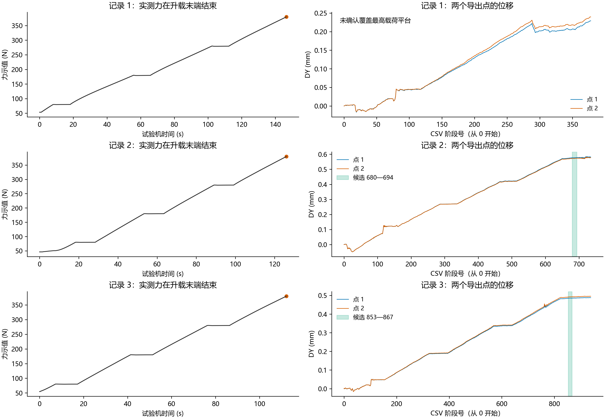
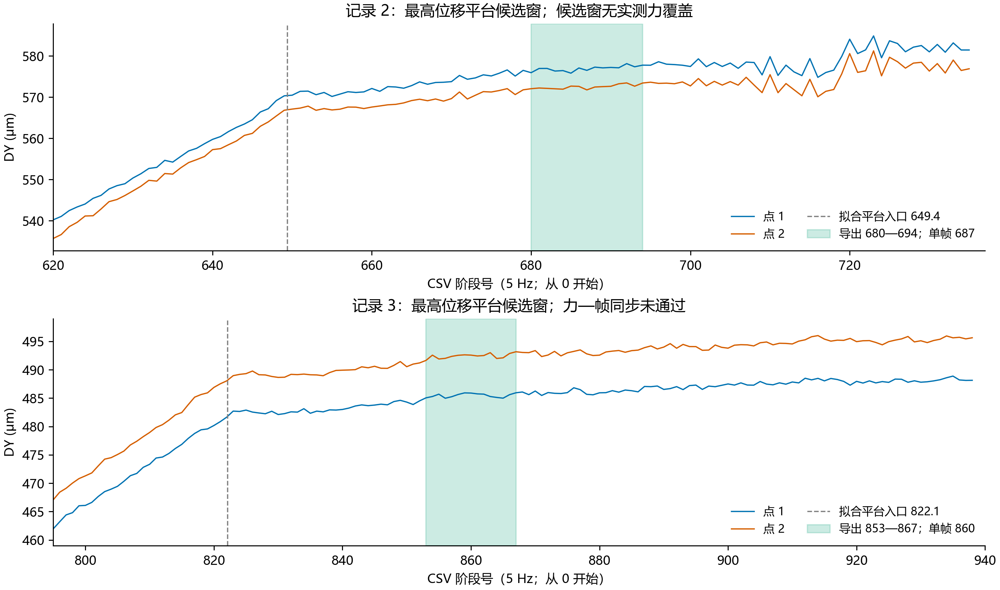

# sample_1 最高载荷全场导出建议

建议优先导出第2次的 **680—694阶段（15帧），单帧取687**。第3次的 **853—867阶段（15帧），单帧取860**可作最高平台全场检查，但力—DIC同步未通过。第1次不选最高载荷帧。这里只选择末段最高平台，不导出较低载荷工况。

以上均为CSV阶段号，从0开始，窗口首尾包含；不保证等于原照片文件编号。两份CSV块分别是两个点，各次有效阶段数为379、736、939，并非两个数据块行数之和。

## 载荷与参考态限制

用户确认三次均为5 Hz，DIC开始早于试验机；本分析保持这一设定。最高位移平台按加载顺序暂对应380 N示值工况，不能只凭位移变平证明实际载荷恒定或精确等于380 N。

| 目录 | 力记录末时刻 / s | 最大已记录示值 / N | DIC建议 |
|---|---:|---:|---|
| 1 | 146.52 | 379.81519 | 未识别到完整末段最高平台；不选 |
| 2 | 126.02 | 379.72079 | 680—694，优先 |
| 3 | 112.20 | 379.81281 | 853—867，仅候选 |

三次最大已记录示值均在最后一行，结束时仍在升载，没有记录380 N保载段。不能把这些末行数值配给后续DIC平均场。第2次候选窗估计对应试验机131.78—134.58 s，晚于126.02 s终点；四个事件给出的全部启动偏移均得到同一“无覆盖”结论，不做记录外恒力外推。

最初0.08 s五个力读数中位数分别为53.4280、46.3272、54.6128 N。这些只是记录开始时的示值，尚未确认全为夹具偏置，也未确认早于试验机启动的DIC参考图与该力状态相同。因此不套用sample_2的60.1 N，不给出本组正式净力。若仅作“380 N减初始示值”的算术，会得到不同值，但现有证据不足以把它们解释为参考态一致的试样净拉力。

## 选帧依据与稳定性

先用连续分段直线拟合“升载—保载—再升载”，允许保载段持续漂移；DIC采用soft-L1稳健拟合。再对末段拟合“升载—平台”单转折，选平台入口后6—9 s。该延迟沿用项目既有选时口径，不按模量、标定或反演误差挑帧。两个点平均信号仅用于事件定位，不能代替全场伸长或应变。

| 目录 | 最高位移平台拟合入口 | 入口敏感性范围（阶段） | 候选窗标准差 / μm | 窗内线性总漂移 / μm | 去趋势RMS / μm |
|---|---:|---:|---:|---:|---:|
| 2 | 649.40 | 649.15—650.28 | 0.536 | 1.370 | 0.300 |
| 3 | 822.12 | 821.45—823.09 | 0.346 | 0.509 | 0.295 |

入口敏感性检查独立拟合两个点及其均值，并将拟合起点后移15、30阶段，共九次；这些范围不是统计置信区间。上表波动包含实际运动和相关误差，不是全场DIC精度，不除以√15。选择的15帧覆盖14个时间间隔，即2.8 s。

## 同步核验

定义`t_machine = stage/5 - offset`，DIC先启动时offset应为正。只用180/280 N两段的四个转折核验，不用位移与载荷的幅值拟合，也不以最终最高平台反过来调时间。

第2次四个offset为3.926, 4.053, 4.414, 4.384 s，中位数4.218 s，跨度0.488 s。两段保载各约10.09、9.92 s，与力记录约9.97、9.95 s基本一致；事件回归得到5.055阶段/s，仅作一致性诊断，实际设定保持5 Hz。启动偏差仍有约半秒的事件离散，不能称精确硬件同步。

第3次四个offset为23.391, 27.715, 37.991, 41.970 s，跨度18.579 s，不能由一个启动差解释。两个DIC平台长14.31、13.98 s，力记录相应平台约9.99、10.00 s。自由事件回归约7.066阶段/s，仅说明不匹配，不推翻用户确认的5 Hz、不将其改设为7 Hz。应核对force.xlsb与disp.csv是否来自同一次采集、阶段号与原图映射、导出阶段定义及实际时间戳；不能仅凭总时长或末段位移强行对齐。

第1次没有可确认的末段最高平台，且中间突变使事件对应不充分；不根据最终力值把末帧378标成380 N。

## 全场导出内容

1. 优先导出目录2的680—694全部15帧；如只导出一帧，取687。
2. 目录3可导出853—867全部15帧检查空间相关质量；如只导出一帧，取860，明确标注“载荷配对未核验”。
3. 各次保留自身原始参考图/参考坐标、阶段号—照片名对应，以及相同ROI的X、Y、DX、DY和相关质量/有效点标记。参考图用于坐标与位移基准，不是额外低载荷识别工况。
4. 全场平均前核对共同参考图、坐标、有效点集合及逐区轴向伸长随帧变化；单点平稳不能保证全场应变平稳。不要先只导出平均场而丢弃逐帧数据。

目前结论仅为选帧建议，未进行模量反演。若无补充最高平台实测力，后续使用380 N示值或任何净力均须明确假定；第3次还需先解决配对矛盾。





## 复现与来源

原始输入为../../1、../../2、../../3中的disp.csv和force.xlsb，均未修改。analysis.json保存六个输入SHA256、拟合结果、环境、源代码哈希和运行时Git版本；selected_frames.csv保存候选清单。PNG与SVG来自同一最终figure状态。

从项目根目录执行：

```powershell
& 'C:/Users/zhu_g/.cache/codex-runtimes/codex-primary-runtime/dependencies/python/python.exe' -X utf8 -B post_tensile_test/1016/sample_1/analysis_results/max_load_20261026/analyze_max_load.py
```

脚本复用既有abqinter中的缺失解析/科学计算库，不安装或修改环境。复跑只更新本分析目录，不改变原始数据或已有反演结果。
