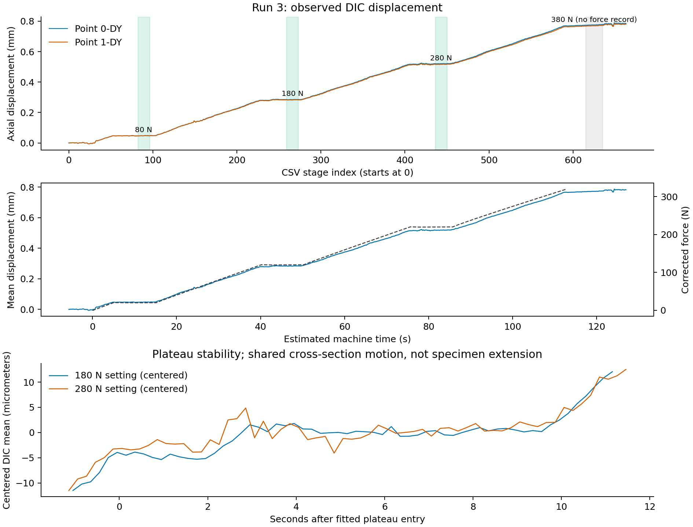
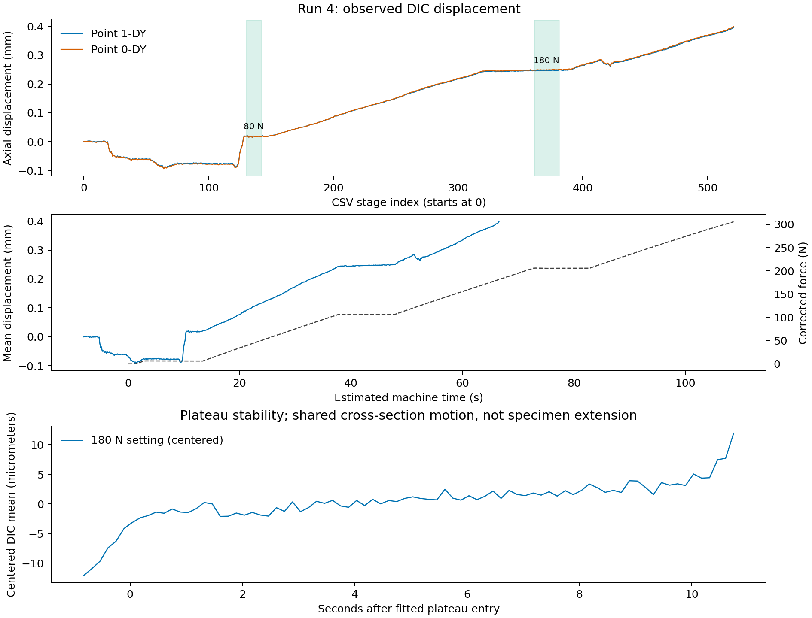

# DIC时刻选择与载荷配对

建议以第3次试验作为首轮反演数据：180 N示值平台取CSV阶段266，280 N示值平台取阶段443。第4次暂取阶段371作为补充，并优先核实原照片时间及早期突变。这里所有阶段号均指CSV中的第二列整数，从0开始；不保证等于原照片文件编号。

## 来源、时间定义及假设

- 原始DIC：../../DY_3.csv、../../DY_4.csv，编码GB18030，每个文件包含两个点的独立数据块。
- 对应载荷：../../sample_2_3.xlsb、../../sample_2_4.xlsb。
- 两点大致在同一横截面，用两点平均轴向位移定位加载事件。两点差不是平行段伸长。
- CSV表头虽然标注“时间[秒]”，但数据为0、1、2等整数。按用户给定采样率将其作为阶段索引处理。第3次664个时刻，按5 Hz覆盖132.6 s；第4次522个时刻，按7 Hz覆盖74.43 s，按5 Hz覆盖104.2 s。
- 各次夹具力偏置采用试验机最初0.08 s内五个读数的中位数，分别60.1000 N、73.9664 N。
- 时间映射为 t_machine = stage / frequency - offset。只对包含在试验机记录内的时刻插值，不向记录外延长恒力平台。
- 有效阶段按顺序连续且没有中途未记录的时间缺口，是采用单一offset的前提。原照片时间戳尚未提供。

## 同步证据

用连续三段直线拟合“加力—保载—再加力”的转换，平台斜率允许非零。DIC采用稳健拟合，避免少数突变主导转换点；不要求DIC位移与力的幅值成比例。

第3次80/180/280 N平台的DIC拟合边界分别约为阶段51.91—103.29、228.24—278.48、405.70—457.04。对应六个转换点给出的offset为5.37—5.95 s，中位数5.62 s。该范围反映不同事件定位的离散程度，不是统计置信区间。所选窗口均远离转换点，约0.3 s的偏移变化不会把它们移出平台。

第4次完整平台边界为阶段318.75—388.44，包含约69.68个采样间隔；试验机180 N平台长10.047 s，反推有效采样率6.94 Hz。按7 Hz，入口/出口的offset分别为7.95/7.86 s；按5 Hz则分别为26.16/30.05 s，无法由同一个启动时间差解释。独立拟合较早平台结束点约为阶段150.58，按7 Hz给出offset8.15 s，进一步支持约7 Hz及约7.9 s时间差。

因此保留原先7 Hz解释更符合现有事件间距。5 Hz不能仅因总时长接近试验机记录而采用。上述判断仍需照片时间戳核实，尤其不能据此排除早期缺图或更早发生的阶段缺失。

## 推荐窗口

为减少不同保载延迟造成的比较差异，主工况统一取DIC拟合平台进入后6—9 s。窗口首尾均包含，代表阶段取窗口中点。实际拉力为扣除夹具偏置后的窗口平均值。

| 试验 | 示值平台 | 推荐阶段范围 | 单帧阶段 | DIC相对首帧时间 | 估计试验机时间 | 窗口平均实际拉力 | 两点平均位移的窗口标准差 |
|---|---:|---:|---:|---:|---:|---:|---:|
| 3 | 180 N | 259—273，15帧 | 266 | 53.2 s | 47.58 s | 119.78 N | 0.64 μm |
| 3 | 280 N | 436—450，15帧 | 443 | 88.6 s | 82.98 s | 219.74 N | 0.59 μm |
| 4，暂按7 Hz | 180 N | 361—381，21帧 | 371 | 53.0 s | 45.10 s | 105.93 N | 0.76 μm |

三处窗口内平均位移的线性漂移总量分别约0.91、0.67、1.63 μm。该标准差和漂移描述这两个点的共同运动，不是全场DIC不确定度，也不能独立证明应变稳定。第4次仍可见持续漂移，不能解释为完全静止。

若只导出一帧，用推荐单帧；对应单帧实际拉力约为119.78、219.74、105.94 N。若平均多帧位移场，使用同窗口载荷均值。全场平均前须保证共同坐标、参考图像和有效点掩膜一致；先检查位移梯度与各区伸长随时间的变化，再判断是否适合平均。

## 建议同时导出的参考状态

第4次在阶段124—128附近出现两点共同的明显正向跳变，单个相邻阶段最大变化约0.0344 mm；较早还存在负向运动。仅凭同一横截面的两点无法区分夹持滑移、相机/试样刚体运动、相关错误或照片缺失。

可以额外导出80 N示值平台的稳定状态，构造增量反演，避免早期共同跳变直接进入观测差值：

| 试验 | 参考阶段范围 | 单帧参考阶段 | 目标阶段 | 窗口平均力增量 |
|---|---:|---:|---:|---:|
| 3 | 82—96 | 89 | 266 | 99.96 N |
| 3 | 82—96 | 89 | 443 | 199.92 N |
| 4，暂按7 Hz | 130—142 | 136 | 371 | 99.84 N |

定义 Δu(x)=u_target(x)-u_reference(x)，ΔF=F_machine,target-F_machine,reference。上表增量力对应窗口平均场相减，单帧相减应重新使用两个单帧对应的力。夹具恒定偏置在力差中抵消。

这种做法在小变形线弹性、两状态间没有显著滑移/损伤/蠕变且处理好刚体运动时成立，不能修复DIC失相关或消除真实加载历史效应。第4次参考窗口位于突变之后、再加载之前；仍需检查该参考及目标的完整位移场。

第3次两个目标相对参考的截面平均位移增量约为0.23643、0.47080 mm，在约100、200 N增量下比例接近2，可作为这两个点的初步一致性检查；这些值包含该截面的刚体运动，不能直接当作试样伸长或据此计算模量。

## 不推荐的状态与范围

- 80 N示值对应实际拉力只有约20 N和6 N，不作为首轮反演的主要目标工况，但可作为增量参考。
- 第3次后部确有近似平台，按加载顺序可能对应380 N保持阶段；它落在试验机记录终止以后，缺少同步实测力，不用于当前正式配对。
- 按7 Hz及约7.9 s对齐，第4次结束时对应试验机约66.52 s，尚未到280 N平台约72.69 s的入口。当前CSV不能提供完整280 N保载状态。提前终止与用户所述软件闪退相容，但不能由CSV证明照片具体丢失方式。
- 两点同截面，现有证据只用于选时和同步，不能替代全平行段位移/应变稳定性检查。

## 复现与保存

使用 bundled Python 执行同目录 analyze_dic_timing.py；仅在缺少相应能力时从现有abqinter环境加载pyxlsb、scipy及matplotlib，不安装或修改依赖。原始CSV/XLSB均保持不变。

同目录 timing_checks.json 保存输入SHA256、环境信息、拟合边界、窗口统计及增量配对；selected_dic_windows.csv保存简表。每次试验的PNG/SVG由同一最终figure状态生成。

