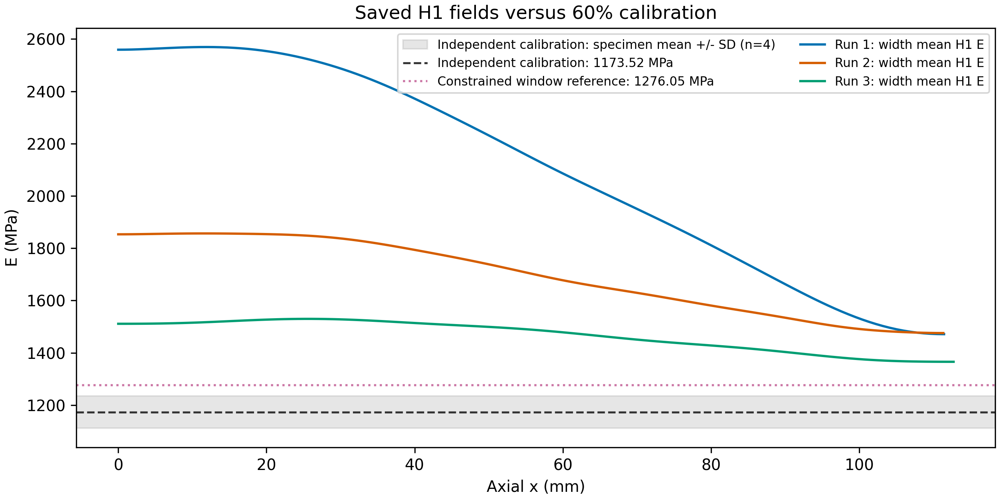

# 60%均匀试样：H1反演与标定模量比较

**第3次空间上最接近均匀，但其模量均值仍高于默认独立标定24.96%；三次尚不能认为同时恢复了均匀性与标定模量水平。**

主参照为当前配置采用的1023当前试样60%独立标定：1173.52±61.87 MPa，n=4，方法`common_stress_window_OLS`。±表示不同标定试样的样本SD，不是均值置信区间或允许误差阈值。

均值偏差=100×(面积均值E/Ecal−1)；整场相对RMS差异=100×sqrt(面积均值((E−Ecal)²))/Ecal。前者衡量整体偏高/偏低，后者同时计入空间非均匀性。CV仅衡量场内离散，不能代替标定一致性。

| 加载 | H1面积均值 MPa | 空间CV % | 相对独立标定均值偏差 % | 整场相对RMS差异 % |
|---|---:|---:|---:|---:|
| 1 | 2107.20 | 20.58 | +79.56 | 87.73 |
| 2 | 1693.49 | 8.54 | +44.31 | 45.99 |
| 3 | 1466.40 | 4.18 | +24.96 | 25.50 |

另列后来按组内±3%及填充率单调性联合选段的参照：1276.05±30.42 MPa，n=4，方法`individual_window_joint_3pct_monotone`。这些约束参与了标定窗口选择，不能与无约束独立标定混称，也不应因为更接近反演就替换主参照。

| 加载 | 相对约束选段参照均值偏差 % | 整场相对RMS差异 % |
|---|---:|---:|
| 1 | +65.13 | 73.47 |
| 2 | +32.71 | 34.62 |
| 3 | +14.92 | 15.67 |

均匀单参数DIC拟合的均值分别为2084.05、1693.03、1473.10 MPa，与自由二维反演的均值很接近。因此整体偏高并非仅由空间非均匀性造成；它已经存在于均匀DIC拟合中。此判断不确定具体误差来源。

主ν=0.26，其他ν=0.24/0.28/0.33的完整比较及均匀基线均保存在两张comparison CSV中。相同γ的ν敏感性结果不用于换选主ν或选参。

比较范围：标定与DIC并非同一根试样；标定是在原始工程应力—应变曲线上选定线性段的斜率，DIC按用户指定的记录始末力差及参考图位移反演，相应加载区间与参考对应尚未证明等价。独立标定60%共同应力窗口约5.986—8.779 MPa；下表仅由记录起载、采用末载和DIC宽度×3.2 mm计算，不能视为已核实的DIC参考应力。

| 次数 | 记录起始应力 MPa | 采用末载应力 MPa | 增量应力 MPa |
|---|---:|---:|---:|
| 1 | 0.800 | 6.595 | 5.796 |
| 2 | 1.216 | 4.950 | 3.734 |
| 3 | 4.266 | 6.462 | 2.196 |

以上差异作为标定参照一致性结果报告，不能据此单独归因于反演算法错误、DIC错误或材料真实变化。需进一步核实力—参考帧对应、DIC覆盖宽度与实际承载宽度、实际厚度、标定应力窗口转移以及标量各向同性边界模型。第1/2次末载仍为用户假定380/280 N，第3次起始记录为250.72479 N；不按标定倒调力或γ。

本次只对保存结果追加比较，未重新反演、未修改原始数据或既有数值场。标定均值与样本SD已用Python statistics从保存的逐根标定表独立重算核对。输入哈希与命令见metadata.json；源标定CSV的副本保存在本目录。

复现：`python -B -m lib.uniform_calibration_comparison --summary <原uniformity_summary.csv> --profiles <原axial_profiles.csv> --audit <原input_audit.json> --calibration <独立group_summary.csv> --secondary-calibration <约束选段group_summary.csv> --output <新目录>`。
