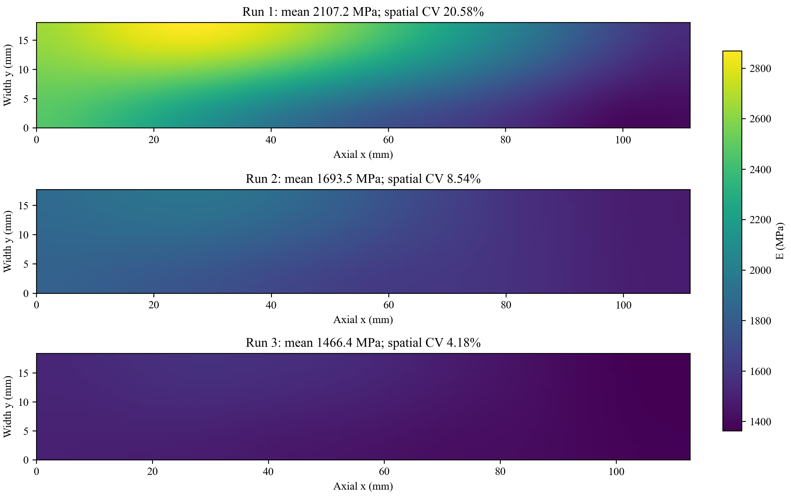
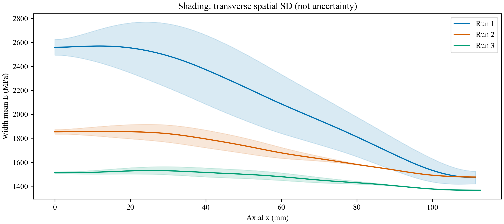
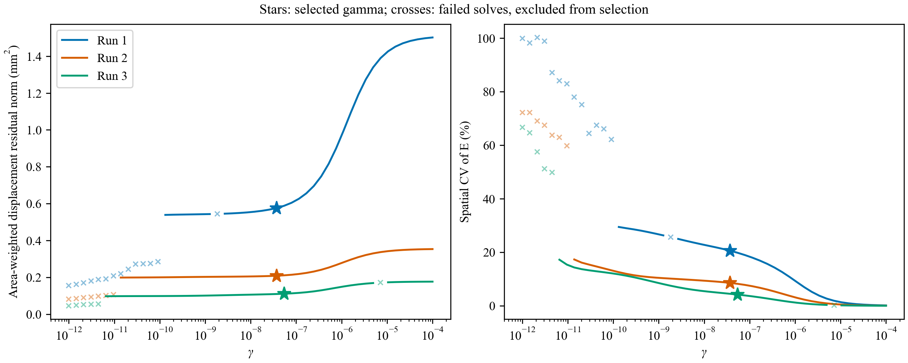

# 1026 均匀 60% 试样：自由二维 H1 反演

三次均获得L-curve所选解，但不能认定三次稳定恢复了均匀模量场。第3次最接近均匀，仍存在沿轴向的平缓趋势；第1、2次非均匀程度更大。未事先规定均匀性验收阈值，以下为定量描述。
第1次：面积均值2107.20 MPa，空间CV=20.58%，内部CV=18.02%；轴向/横向相对RMSE分别4.76%/38.39%。
第2次：面积均值1693.49 MPa，空间CV=8.54%，内部CV=7.57%；轴向/横向相对RMSE分别1.72%/49.56%。
第3次：面积均值1466.40 MPa，空间CV=4.18%，内部CV=3.71%；轴向/横向相对RMSE分别2.23%/43.57%。

三次独立参考图分别反演，不合并为多载荷同参考数据。厚度约3.2 mm，长宽取各自DIC参考坐标跨度；原Y换为FEM轴向x，原X换为横向y，坐标和位移保持同一毫米尺度。

模型为平面应力、两端均匀牵引及侧面自由；主ν=0.26，ν=0.24/0.28/0.33为同γ敏感性比较。每次121×19单元、2440个独立节点模量；目标为0.5*r.T@W_area@r+0.5*γ*∫|∇E|²，不强制均匀。

γ只用该次DIC的原有50点L-curve规则选择，范围1e-12—1e-4；无有效拐点时不补选。初值只来自该次DIC的均匀拟合，独立标定未进入初值、目标或选参。

| 次数 | 长×宽 mm | 起载 N | 末载 N | 增量 N | 末载来源 |
|---|---:|---:|---:|---:|---|
| 1 | 111.443×18.005 | 46.07440 | 380.00000 | 333.92560 | 用户假定平台末载，无同期载荷 |
| 2 | 111.342×17.678 | 68.76560 | 280.00000 | 211.23440 | 用户假定平台末载，无同期载荷 |
| 3 | 112.728×18.366 | 250.72479 | 379.78479 | 129.06000 | 记录最后一条 |

**参考状态限制：** 始末差值按用户指定口径计算。尤其第3次起始记录已为250.72479 N，早于该记录起点的DIC参考帧载荷尚未同步核实。因此绝对模量依赖此参考对应关系、DIC覆盖宽度等于承载宽度以及厚度近似值。第3次窗口均值379.6495967 N与末记录379.78479 N相差0.13519 N，相当于本次增量的0.105%。

扫描若仅因L-BFGS线搜索异常缺少拐点支撑，使用项目既有--resume恢复接口：只重置该候选的L-BFGS历史，迭代与函数调用累计仍限制在原1500/12000预算内。原候选、恢复候选和恢复前选参表分别保留；不追加预算，不依据均匀程度或标定结果补选γ。

| 次数 | 模型 | ν | γ | 面积均值 MPa | 空间CV % | 内部CV % | 轴向相对RMSE % | 横向相对RMSE % |
|---|---|---:|---:|---:|---:|---:|---:|---:|
| 1 | uniform_baseline | 0.26 | — | 2084.05 | 0.00 | nan | 17.26 | 94.48 |
| 1 | H1 | 0.26 | 3.73e-08 | 2107.20 | 20.58 | 18.02 | 4.76 | 38.39 |
| 2 | uniform_baseline | 0.26 | — | 1693.03 | 0.00 | nan | 5.52 | 75.81 |
| 2 | H1 | 0.26 | 3.73e-08 | 1693.49 | 8.54 | 7.57 | 1.72 | 49.56 |
| 3 | uniform_baseline | 0.26 | — | 1473.10 | 0.00 | nan | 3.64 | 68.97 |
| 3 | H1 | 0.26 | 5.43e-08 | 1466.40 | 4.18 | 3.71 | 2.23 | 43.57 |

CV=面积加权空间标准差/面积均值，不是参数不确定性。内部统计仅用轴向与横向各10%—90%范围内的Gauss点；全域一、二阶矩使用Q4的2×2 Gauss积分。未预设通过/失败阈值。横向阴影是空间SD，不是置信区间。

相对位移误差的分母为DIC去掉两平移和一微小转动后的相应分量RMS，全部测点共用，不逐点除以过零位移。这里只移除刚体模式，不删除仿射伸长/收缩。

均匀基线只有一个E参数，采用相同几何、载荷、ν、观测位置和面积权重。其拟合模量同时用均匀有限元解和解析单轴柔度的独立计算核验到相对1e-7。保存反演场重新正演得到的残差与已保存轴向RMSE核验一致；全部ν的停止信息和GTOL状态见uniformity_summary.csv。函数下降停止不等于满足梯度阈值。

同一数据用于反演和回代，以上是拟合检查，没有独立物理验证。较大γ必然更偏好均匀场，因此应结合gamma_tradeoff与均匀基线判断；不能通过挑选最均匀的候选宣称恢复成功。正反演使用同一标量各向同性模型，空间变化也可能吸收边界、各向异性、参考状态或DIC系统误差，不能直接认定为材料真实非均匀。

全域仿射应变诊断（原DIC轴，不作为材料泊松比测量）：
- 第1次：εXX=-0.00295007，εYY=0.002765464，−εXX/εYY=1.0668。该比值与预设ν差异较大，提示均匀各向同性单轴模型的适用性需另验。
- 第2次：εXX=-0.001420239，εYY=0.002199804，−εXX/εYY=0.6456。该比值与预设ν差异较大，提示均匀各向同性单轴模型的适用性需另验。
- 第3次：εXX=-0.0007686086，εYY=0.001488028，−εXX/εYY=0.5165。该比值与预设ν差异较大，提示均匀各向同性单轴模型的适用性需另验。

复现：各次源配置已冻结在对应01_prepared/configuration_snapshot.py；对各冻结输入分别执行script.step3_inverse_dic，已有目录拒绝覆盖。后处理命令见lib/uniform_sample_analysis.py，使用--cases、--audit和新的--output。所有原始输入SHA256见input_audit.json，上游结果身份见provenance.json；详细数值场和全部50点候选在以下本地目录：
- D:\MyProject\uniform_pressure_experiment_1023\results\dic_full\60sample_1026_run1_h1_20261026
- D:\MyProject\uniform_pressure_experiment_1023\results\dic_full\60sample_1026_run2_h1_20261026
- D:\MyProject\uniform_pressure_experiment_1023\results\dic_full\60sample_1026_run3_h1_20261026
