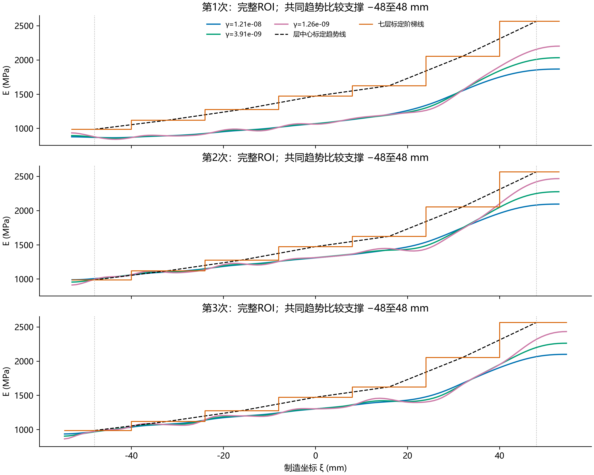

# 小γ结果与标定趋势线、分层线的事后比较

原完整ROI，ν=0.26。γ≈1.3e-9的精确值为1.2648552168552956e-9。所有数值为事后诊断，不按标定最小误差重新选择γ。

趋势线定义：七层中心制造坐标−48/−32/−16/0/16/32/48 mm上的本次1023单调约束标定均值作分段线性连接，仅在[−48,48] mm使用，不外推。中心按16 mm层间距延续到两个外层，是辅助绘图/评价约定，不是真实连续材料场。分层线按已配置−40/−24/−8/8/24/40 mm界面分为七层常值。

主指标为反演宽度均值曲线的平均绝对相对误差：100/(b−a) × ∫|Ē(x)/E_ref(x)−1|dx。两条线均在相同[−48,48] mm上评价。另列完整ROI的分层曲线误差及七层均值误差；后者为七层各自均值相对差绝对值的等权平均，与曲线逐位置误差不同。

| 次数 | γ | 趋势线误差 % | 分层线误差 %（共同支撑） | 分层线误差 %（完整ROI） | 七层均值误差 % |
|---|---:|---:|---:|---:|---:|
| 1 | 1.21e-08 | 24.0150 | 23.7388 | 23.3377 | 23.1749 |
| 1 | 3.91e-09 | 23.5981 | 23.3352 | 22.6157 | 22.3386 |
| 1 | 1.26e-09 | 23.3105 | 23.0657 | 21.9577 | 21.5711 |
| 2 | 1.21e-08 | 9.3769 | 9.7048 | 9.7020 | 9.7163 |
| 2 | 3.91e-09 | 9.0491 | 9.2528 | 9.0189 | 8.7691 |
| 2 | 1.26e-09 | 8.8700 | 8.9517 | 8.5235 | 7.9291 |
| 3 | 1.21e-08 | 10.8688 | 10.8695 | 10.9067 | 10.6305 |
| 3 | 3.91e-09 | 10.6402 | 10.6792 | 10.4814 | 10.1449 |
| 3 | 1.26e-09 | 10.5379 | 10.5269 | 10.0553 | 9.7200 |

全扫描中各指标最接近标定参照的点（仅限原停止标志通过者；不是正式最优γ）：

| 次数 | 指标 | γ | 相对误差 % |
|---|---|---:|---:|
| 1 | 趋势线 | 4.292e-11 | 22.1258 |
| 1 | 分层线（共同支撑） | 4.292e-11 | 21.9008 |
| 2 | 趋势线 | 8.685e-10 | 8.8476 |
| 2 | 分层线（共同支撑） | 4.095e-10 | 8.8164 |
| 3 | 趋势线 | 1.265e-09 | 10.5379 |
| 3 | 分层线（共同支撑） | 6.251e-11 | 10.3767 |

本次对七层边界精确切分后积分，因此七层均值误差与旧报告直接按有限元Gauss点归区的近似值可能略有差别。新数值没有覆盖旧结果。主表只评价宽度均值；二维横向起伏仍须结合已有二维场和稳定性报告，不能用曲线相近证明二维模量场正确。

核验：常值场10%相对差及完全匹配趋势线零差异解析检查；在有限元节点、层中心、制造界面及误差过零点切分，6点和12点Gauss积分逐场核对到1e-10相对/绝对容差。未运行优化、修改参考值或正式γ。L₂相对误差另存CSV，避免将不同指标混称。

复现：`python -B -m lib.dic_calibration_curve_comparison --cases <三个完整ROI冻结目录> --study <小γ稳定性目录> --output <新输出目录>`。
