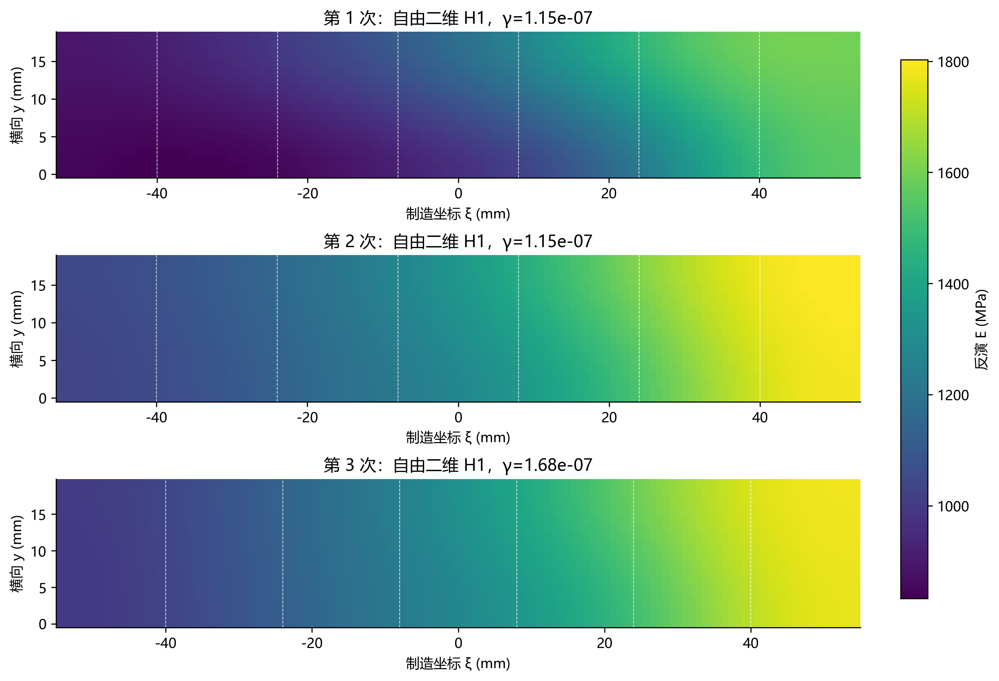
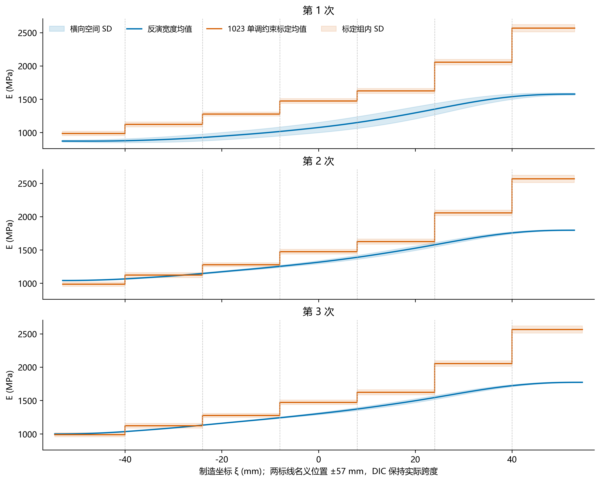
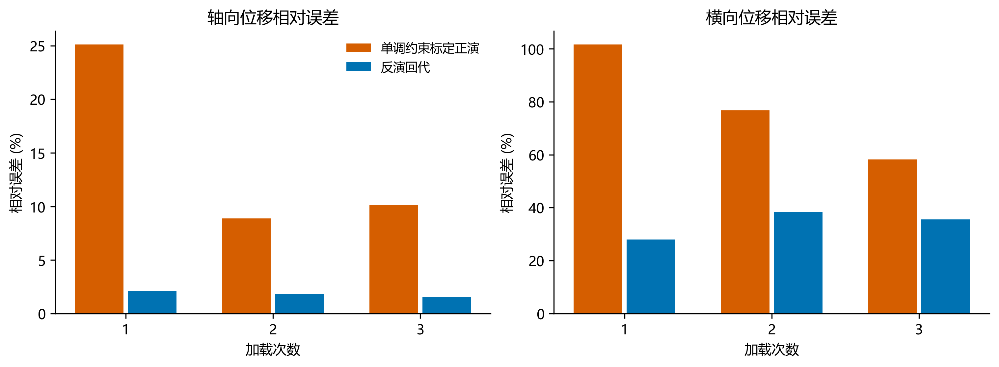

# 1026 sample_2：三次独立参考图的四步自由二维 H1 反演

**结论：** 使用随填充率不减的标定分布重新正演及比较。三次反演得到沿高填充率端增大的模量趋势，但绝对模量与约束标定参照仍有差异，尤其100%区偏低。第2、3次宽度均值曲线较接近，第1次整体偏低。

标定来源为 individual_3pct_monotone_20261026_final/group_summary.csv，fit_method=individual_window_joint_3pct_monotone。40%至100%均值依次为985.32/1119.96/1276.05/1472.30/1623.17/2055.18/2566.71 MPa。每组4根，保留各组SD；组内3%及随填充率不减是标定选窗的显式约束，未施加到空间反演。

此次仅更换外部标定参照：重新冻结输入、重算标定正演、更新区域相对误差与图件。已核验原反演的全部准备数组、观测算子、权重、载荷、目标和停止设置一致，复用原模量场、位移、γ及扫描记录，未重新优化；12组ν模量/位移数组逐元素完全一致。原始优化试验元数据保留在复制的l_curve目录，来源与哈希见 inverse_reuse_checks.json 和各次03_inverse/run_metadata.json。

厚度约 3.2 mm；长宽与承载宽度使用各次 DIC 参考跨度，原 Y 为轴向 x。用户明确将几何/载荷口径及力参考对应视为假设。两标线距 220 mm 试样两端各 53 mm，制造坐标为 ±57 mm；按中点定位，不缩放 DIC 实际跨度。七区填充率沿原 +Y 由 40% 增至 100%，界面为 −40/−24/−8/8/24/40 mm。

每次单独冻结输入、单独标定正演、单独 L-curve 选参及反演，PREDICT_CASES=()。121×19 单元、2440 个独立节点模量，保留独立 y 行。H1 目标为 0.5*r.T@W_area@r+0.5*γ*∫|∇E|²；γ 为 1e-12–1e-4 共 50 点，初值和选参均只用本次 DIC。七区标定及其批次、n、SD 只作外部参照，不进入初值、目标或选参。主 ν=0.26；0.24/0.28/0.33 为同 γ 敏感性比较。

| 次数 | 长×宽 mm | 起载 N | 假定末载 N | 增量 N | 标线间距−DIC跨度 mm |
|---|---:|---:|---:|---:|---:|
| 1 | 105.926×18.436 | 50.77760 | 280 | 229.22240 | 8.074 |
| 2 | 105.775×18.464 | 70.61920 | 380 | 309.38080 | 8.225 |
| 3 | 109.055×19.302 | 82.28480 | 480 | 397.71520 | 4.945 |

**参考限制：** 三次窗口均无同期力记录。末载假定为 280/380/480 N，减去各自记录首载；假定该首载对应 DIC 第0帧。这些不是实测配对的窗口均值。实际DIC跨度与名义114 mm不一致，采取中点对齐而不缩放，因此分区位置是条件定位。模型采用平面应力、各向同性、端部均匀牵引和侧面自由近似；实际边界等效与尺度仍须物理核验。

| 次数 | 模型 | γ | 轴向位移相对误差 % | 横向位移相对误差 % | 双分量位移相对误差 % | 七区模量平均绝对相对误差 % |
|---|---|---:|---:|---:|---:|---:|
| 1 | 单调约束标定正演 | — | 25.119 | 101.615 | 29.900 | — |
| 1 | 反演回代 | 1.15e-07 | 2.111 | 27.941 | 5.052 | 24.915 |
| 2 | 单调约束标定正演 | — | 8.878 | 76.787 | 9.901 | — |
| 2 | 反演回代 | 1.15e-07 | 1.842 | 38.277 | 2.867 | 11.824 |
| 3 | 单调约束标定正演 | — | 10.153 | 58.236 | 10.625 | — |
| 3 | 反演回代 | 1.68e-07 | 1.583 | 35.551 | 2.503 | 12.388 |

位移采用面积加权L₂相对误差：ε_c=100×√Σ[w_i(u_model,c−u_DIC,c)²]/√Σ[w_i(u_DIC,c的变形分量)²]。分母由DIC去除两平移和一微小转动后的变形量确定；双分量形式对两个分量一同求和。所有模型共用同一DIC分母，不逐点除以过零位移。该范数比与此前分量百分比在数学上等价，因此反演位移百分比不因参照表改变而变化；本报告统一采用相对误差名称及百分数。

区域模量有符号相对误差为100×(E_inverse_mean−E_calibration_mean)/E_calibration_mean；汇总为七区绝对相对误差的算术均值。分母使用单调约束标定参照，不是已知材料真值。完整逐区数据、n、标定SD和反演空间SD见 regional_comparison.csv。横向空间SD与标定组内SD不是参数置信区间。

## 求解与核验

| 次数 | ν | 停止 | GTOL满足 | 梯度∞范数 | 扫描成功数/50 |
|---|---:|---|---|---:|---:|
| 1 | 0.24 | CONVERGENCE: RELATIVE REDUCTION OF F <= FACTR*EPSMCH | False | 3.06e-08 | 38/50 |
| 1 | 0.26 | CONVERGENCE: RELATIVE REDUCTION OF F <= FACTR*EPSMCH | False | 2.89e-08 | 38/50 |
| 1 | 0.28 | CONVERGENCE: RELATIVE REDUCTION OF F <= FACTR*EPSMCH | False | 3.28e-08 | 38/50 |
| 1 | 0.33 | CONVERGENCE: RELATIVE REDUCTION OF F <= FACTR*EPSMCH | False | 1.07e-08 | 38/50 |
| 2 | 0.24 | CONVERGENCE: RELATIVE REDUCTION OF F <= FACTR*EPSMCH | False | 6.49e-09 | 45/50 |
| 2 | 0.26 | CONVERGENCE: RELATIVE REDUCTION OF F <= FACTR*EPSMCH | False | 6.89e-09 | 45/50 |
| 2 | 0.28 | CONVERGENCE: RELATIVE REDUCTION OF F <= FACTR*EPSMCH | False | 8.91e-09 | 45/50 |
| 2 | 0.33 | CONVERGENCE: RELATIVE REDUCTION OF F <= FACTR*EPSMCH | False | 1.13e-08 | 45/50 |
| 3 | 0.24 | CONVERGENCE: RELATIVE REDUCTION OF F <= FACTR*EPSMCH | False | 6.24e-09 | 40/50 |
| 3 | 0.26 | CONVERGENCE: RELATIVE REDUCTION OF F <= FACTR*EPSMCH | False | 1.09e-08 | 40/50 |
| 3 | 0.28 | CONVERGENCE: RELATIVE REDUCTION OF F <= FACTR*EPSMCH | False | 1.1e-08 | 40/50 |
| 3 | 0.33 | CONVERGENCE: RELATIVE REDUCTION OF F <= FACTR*EPSMCH | False | 8.11e-09 | 40/50 |

函数下降停止不等于 GTOL 满足。本次三次均由原50点扫描选出有效拐点，未使用 --resume、未增加1500/12000预算、未按标定或期望梯度形状补选 γ。未通过停止条件的候选被排除，其原始场和诊断保留在各03_inverse/l_curve目录。

第4步已用同一冻结输入核对正演、反演与回代记录；此后另对主ν保存模量正演，逐测点残差在1e-10 mm绝对容差下复核。全部45份全场、三份加载和三份单点CSV哈希复核一致。仅更新参照及误差表达，未改力学、观测或梯度实现。

三个结果来自同一试样不同加载/参考图，不能当作三根独立材料样本。回代使用过的位移属于拟合检查，无独立留出物理验证。较好位移拟合不独自证明模量正确；空间差异可能吸收载荷参考、厚度、材料定位、边界、各向异性或DIC系统误差。

## 输出与复现

三次四步结果：
- D:\MyProject\uniform_pressure_experiment_1023\results\dic_full\sample2_1026_run1_h1_monotone_20261026
- D:\MyProject\uniform_pressure_experiment_1023\results\dic_full\sample2_1026_run2_h1_monotone_20261026
- D:\MyProject\uniform_pressure_experiment_1023\results\dic_full\sample2_1026_run3_h1_monotone_20261026

各次01_prepared保存 configuration_snapshot.py 与输入哈希；各步骤分别运行项目四个入口。已有结果拒绝覆盖，其他步骤使用 --input 显式指定冻结01_prepared，不依赖当前根配置已切换到第3次。原始数值结果及50点扫描保存在results/dic_full；本目录仅保存可审阅摘要、图件、输入审计与执行日志。

后处理复现：`python -B -m lib.sample2_result_analysis --cases <三个运行目录> --audit <input_audit.json> --output <新报告目录>`。执行环境、Git版本、命令与源文件哈希保存在四步元数据；本次后处理源文件见项目lib/sample2_result_analysis.py。
