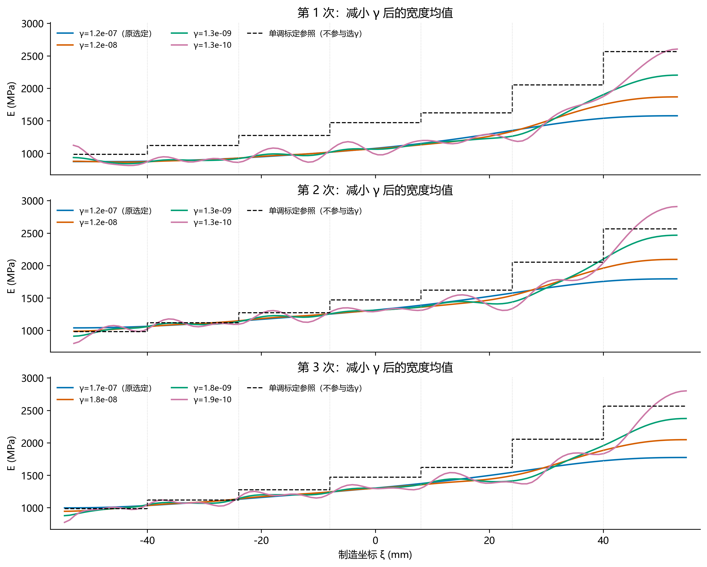
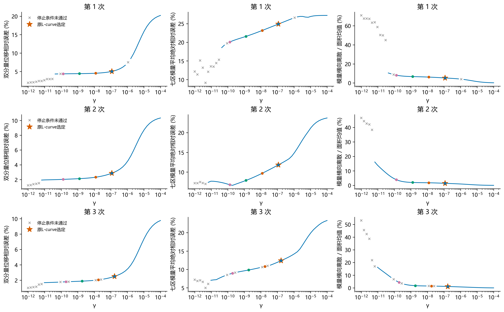
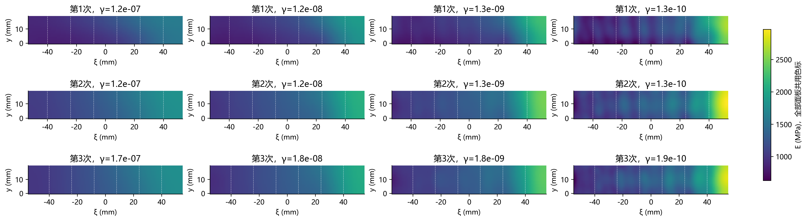

# sample_2：已有 H1 正则化扫描的敏感性检查

**结论：** 当前约1e-7的γ存在平滑偏差的证据。降低到原值约1/100后，三次轴向位移相对误差由2.11/1.84/1.58%降至1.18/0.86/0.78%，七区模量平均绝对相对误差由24.92/11.82/12.39%降至21.60/7.86/9.84%。高填充率端的模量上升更充分。

进一步降低到原值约1/1000，相比1/100的双分量位移误差只再下降1.19/4.57/4.70%，横向离散却分别增至1.22/1.93/2.45倍，宽度均值出现更明显起伏。到更小γ时可出现近零局部模量和停止失败，不能把所有拟合改善视为材料恢复改善。

建议把约1e-9至1e-8作为进一步DIC内稳定性核验的候选区间；这是本次敏感性诊断，不替换正式L-curve选参，也不把标定参照最接近点作为最优γ。

**问题：** 原选定γ是否把有效空间变化过度平滑；更小γ是否改善位移及外部标定参照的一致性。

读取三次原扫描各50个已保存模量场，固定同一ROI、网格、载荷、参考图、ν=0.26、观测、权重与求解预算。逐场重新正演，共150次小型回放；未重新优化，未更改根配置或原L-curve选择。位移均用面积加权L₂相对误差。

图示系数预先按γ原值×1/0.1/0.01/0.001选最近的已有对数网格点，不根据标定误差或图形挑点。所有系数的原始停止信息、GTOL状态与结果保留在all_gamma_metrics.csv；停止条件未通过者仅作灰叉诊断，不能作为成功候选。

| 次数 | γ | 实际γ/原γ | 轴向相对误差 % | 横向相对误差 % | 双分量相对误差 % | 七区模量平均绝对相对误差 % | 100%区有符号相对误差 % | 横向离散 % |
|---|---:|---:|---:|---:|---:|---:|---:|---:|
| 1 | 1.15e-07 | 1 | 2.111 | 27.941 | 5.052 | 24.915 | -39.039 | 5.272 |
| 1 | 1.21e-08 | 0.1048 | 1.363 | 26.396 | 4.551 | 23.187 | -28.708 | 6.174 |
| 1 | 1.26e-09 | 0.01099 | 1.185 | 26.017 | 4.442 | 21.601 | -18.358 | 6.705 |
| 1 | 1.33e-10 | 0.001151 | 1.128 | 25.776 | 4.389 | 20.090 | -10.930 | 8.152 |
| 2 | 1.15e-07 | 1 | 1.842 | 38.277 | 2.867 | 11.824 | -30.503 | 1.444 |
| 2 | 1.21e-08 | 0.1048 | 1.147 | 35.251 | 2.327 | 9.684 | -19.925 | 1.801 |
| 2 | 1.26e-09 | 0.01099 | 0.857 | 33.985 | 2.133 | 7.862 | -8.439 | 2.019 |
| 2 | 1.33e-10 | 0.001151 | 0.719 | 33.131 | 2.035 | 6.752 | +1.410 | 3.902 |
| 3 | 1.68e-07 | 1 | 1.583 | 35.551 | 2.503 | 12.388 | -31.478 | 1.159 |
| 3 | 1.76e-08 | 0.1048 | 0.998 | 32.766 | 2.048 | 10.798 | -22.220 | 1.494 |
| 3 | 1.84e-09 | 0.01099 | 0.780 | 31.462 | 1.886 | 9.843 | -13.307 | 1.796 |
| 3 | 1.93e-10 | 0.001151 | 0.678 | 30.502 | 1.798 | 8.953 | -7.021 | 4.401 |

## 解释与边界

减小γ允许模量梯度增加，数据拟合改善本身是预期行为。必须同时查看二维场、横向离散、极值、停止状态及跨重复加载的一致性，不能只按曲线更接近标定认定恢复了真实材料细节。横向离散是去掉宽度均值场后的面积加权空间标准差/面积均值，不是测量噪声或参数不确定性。

单调标定采用individual_window_joint_3pct_monotone的七组均值，仅在此敏感性检查中作为外部参照。标定差异可说明原解有平滑偏差，但本次不能据此把某γ改称正式最优；这些参照已被用于诊断，也不构成新的独立留出验证。

更小γ还可能吸收DIC误差、材料各向异性、边界近似、未配对的力参考或ROI定位误差；现有比较没有区分这些来源。三次均采用名义末载减记录首载、厚度约3.2 mm及标线中点定位等既有假设。不同γ的初值遵循原有收敛延续路径，而非多初值全局最优检验；所有代表点的函数下降停止与严格GTOL分别报告。

图中宽度均值不抹去二维反演自由度；二维图共享色标，保留横向变化。原γ及正式四步结果保持不变。

## 核验与复现

150个回放的面积加权残差范数及H1梯度范数分别与原扫描记录在1e-7和1e-8相对容差下核对。输入/字段来源哈希和逐场文件路径见provenance.json。标定与反演统计均沿用同一Gauss积分分区规则，不改力学、观测或梯度实现。

复现：`python -B -m lib.dic_gamma_sensitivity --cases <三个monotone运行目录> --output <新目录>`。已有输出拒绝覆盖。
