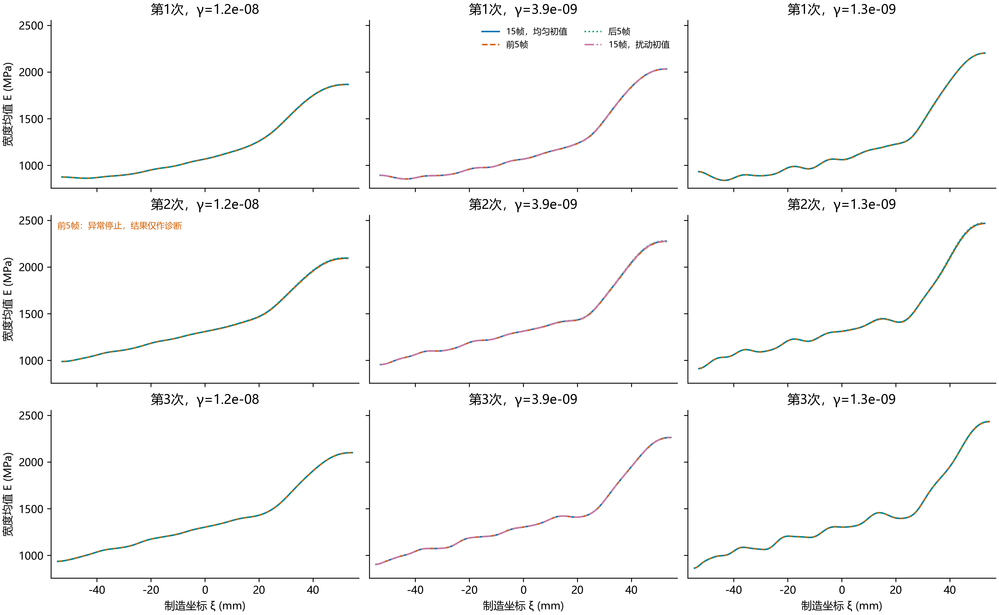
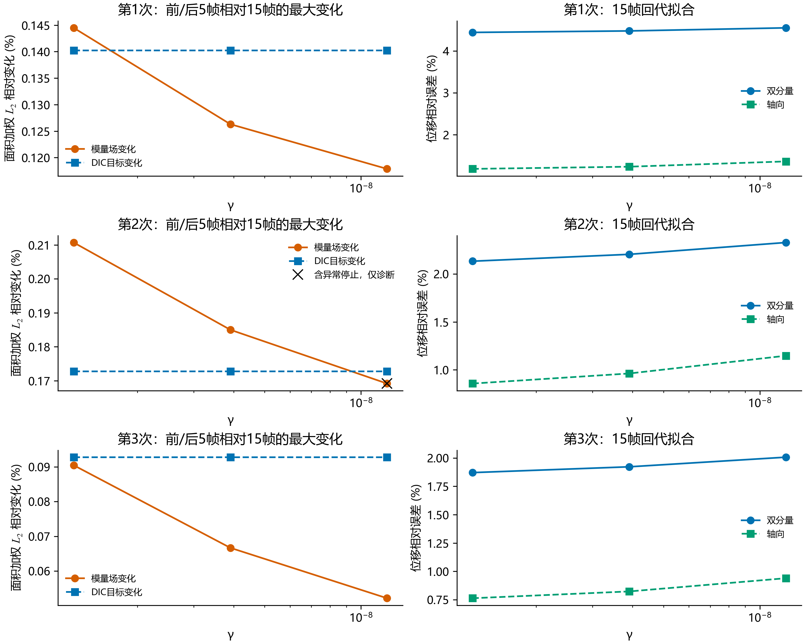

# sample_2：小γ的帧内与初值稳定性检查

**结论：** 在本次固定模型与原完整ROI内，降低γ到1e-9量级后，拟合改善未伴随明显的帧内或初值不稳定。三次在γ=1.26e-9下，轴向位移相对误差为1.185/0.857/0.763%，前后帧导致的模量场相对变化为0.144/0.211/0.090%。这些是二维积分场差异，不是仅凭曲线重合判断。

**建议：** 展示折中结果可采用γ=3.91e-9，同时保留1.26e-9的细节敏感性对照；前者比原约1e-7更少平滑，后者拟合误差更低但起伏更明显。本检查没有给出正式最优γ。局部起伏在不同帧中重现，只能排除本窗口内较大的帧敏感性，仍可能来自共同的观测或模型偏差，不能认定是真实材料细节。

固定原完整ROI、121×19二维H1自由度、ν=0.26、载荷与求解预算。三次试验分别比较三个事先固定的γ；每个γ用15帧、前5帧、后5帧各求解一次，中间γ再以平滑扰动初值求解。共30次，未用标定值参与初值、目标、排序或选γ。

这是原完整ROI结果的稳定性研究，未采用当前日常配置中的40%–70%裁剪ROI；不混合两个几何域的γ和误差。正式L-curve选择与原数值结果保持不变。

| 次数 | γ | 轴向位移相对误差 % | 双分量位移相对误差 % | 帧变化最大 % | 模量场变化最大 % | 均匀初值与原延续路径的场差异 % |
|---|---:|---:|---:|---:|---:|---:|
| 1 | 1.21e-08 | 1.363 | 4.551 | 0.1402 | 0.1179 | 0.000017 |
| 1 | 3.91e-09 | 1.237 | 4.478 | 0.1402 | 0.1263 | 0.000035 |
| 1 | 1.26e-09 | 1.185 | 4.442 | 0.1402 | 0.1445 | 0.000021 |
| 2 | 1.21e-08 | 1.147 | 2.327 | 0.1728 | 0.1692 | 0.000009 |
| 2 | 3.91e-09 | 0.962 | 2.204 | 0.1728 | 0.1850 | 0.000028 |
| 2 | 1.26e-09 | 0.857 | 2.133 | 0.1728 | 0.2107 | 0.000015 |
| 3 | 1.21e-08 | 0.940 | 2.007 | 0.0928 | 0.0522 | 0.000004 |
| 3 | 3.91e-09 | 0.823 | 1.922 | 0.0928 | 0.0667 | 0.000007 |
| 3 | 1.26e-09 | 0.763 | 1.871 | 0.0928 | 0.0905 | 0.000006 |

中间γ的扰动初值与均匀初值模量场相对差异（第1/2/3次）：0.000006% / 0.000003% / 0.000008%。

30次中优化停止标志通过29次；严格梯度阈值通过0次。梯度无穷范数范围为1.4e-10–3.58e-09，配置GTOL=1e-12。函数下降停止不能解释为严格一阶最优性或真实材料恢复。

异常停止为第2次、γ=1.21e-8、前5帧组：175次迭代、313次目标评价后返回ABNORMAL，未提高预算或替换结果；该组仅作诊断。其余29组均因函数相对下降停止。三个γ的15帧均匀初值解与原延续路径场差异均小于0.000036%，同目标函数值差异仅处于约1e-10%的数值量级。

## 定义与解释范围

位移相对误差为面积加权残差L₂范数/去刚体运动后的DIC变形L₂范数，轴向、横向、双分量分别计算；不逐点相除。模量场差异为完整二维Q4场的面积积分L₂差异/基准场L₂范数，不先进行一维化。前后帧场差异以同γ的15帧均匀初值场为基准，初值路径差异以已有扫描场为基准。

前/后5帧均来自原15帧，具有时间相关性，也都已参与过原识别。本检查只能评价帧内重复性与初值敏感性，不能称为独立留出验证。帧间漂移还可能包含真实蠕变或载荷变化；各窗口使用相同假设力，不能将其完全解释为DIC噪声。独立y行自由度始终保留；图中仅展示宽度均值。

厚度3.2 mm、名义末载减记录首载、首载对应参考图及标线中点定位等原假设仍有效。稳定性不能排除共同存在的力、尺度、边界或本构偏差。未更改正式选参规则，也未将这三个候选之一宣称为已验证最优γ。

## 核验与复现

逐次从原始15帧重建坐标和平均位移，与冻结输入在1e-10 mm和1e-12 mm绝对容差内核对；前后5帧使用相同点集、权重、观测算子及统一初值。每个优化结果重新正演，残差范数与求解器结果在1e-8相对容差内核对。模量积分差异通过常值场10%差异和同场零差异两项解析核验。原冻结输入哈希及原选定γ再次核对未变。

运行模块：`python -u -B -m lib.dic_gamma_stability --case <冻结完整ROI目录> --output <新的单次目录>`；三次各自执行。后处理：`python -B -m lib.dic_gamma_stability_report --study <本研究目录> --output <新的汇总目录>`。

逐次protocol.json记录帧源哈希、初值和预算，逐优化metrics.json/fields.npz/solver.log保留停止状态、历史与数值场。all_fit_metrics.csv包含所有交叉帧误差与初值差异，gamma_summary.csv为本表数据。
