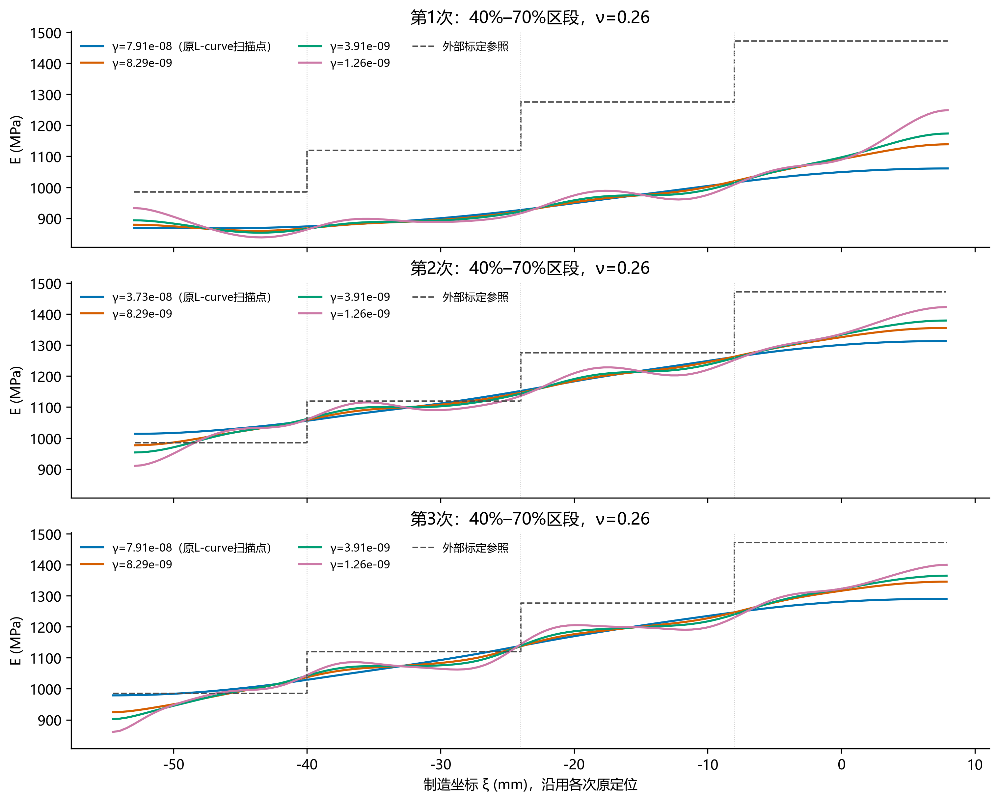
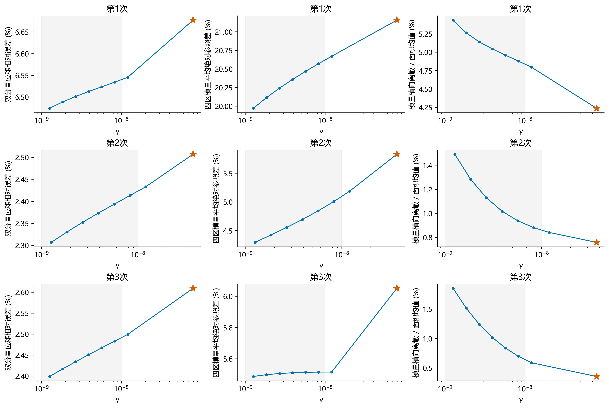
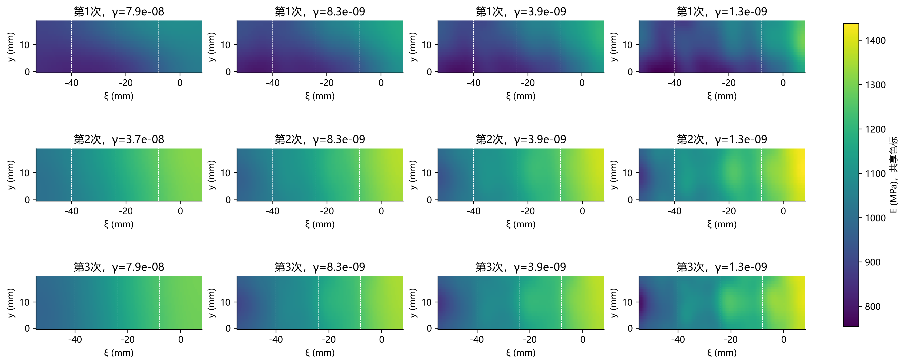

# 40%–70%区段：γ在10⁻⁹至10⁻⁸量级的核验

**结论：** 减小γ可改善拟合并减轻70%端的平滑偏差，但改善有限，曲线起伏和横向离散同时增大。建议先保留约8.29e-9与3.91e-9作稳定性核验候选，不直接采用最低1.26e-9，更不向1e-9以下扩展。本次未修改正式选γ规则，未确认这些候选为最优值。

只回放三次裁剪运行已保存的扫描场。固定同一DIC、ROI、网格、载荷、参考图、面积权重及ν=0.26；不重新优化，不改原γ或根配置。候选为原扫描中1e-9至1e-8的6点，加上上邻点1.20679e-8，每次再加原L-curve点，共24场。

图示代表点预先按目标8e-9、4e-9、1.3e-9取已有扫描中最近点，不按标定或图形挑选；区间内所有点均保留。标定仅用于事后比较，未引入新的正式选参规则。

| 次数 | γ | 轴向位移误差 % | 双分量位移误差 % | 四区平均绝对参照差 % | 70%区参照差 % | 横向离散 % |
|---|---:|---:|---:|---:|---:|---:|
| 1 | 7.91e-08 | 1.351 | 6.677 | 21.155 | -28.985 | 4.237 |
| 1 | 8.29e-09 | 1.302 | 6.534 | 20.571 | -26.059 | 4.880 |
| 1 | 3.91e-09 | 1.316 | 6.512 | 20.358 | -25.303 | 5.045 |
| 1 | 1.26e-09 | 1.315 | 6.474 | 19.971 | -24.197 | 5.436 |
| 2 | 3.73e-08 | 1.099 | 2.507 | 5.831 | -12.004 | 0.759 |
| 2 | 8.29e-09 | 1.083 | 2.413 | 5.005 | -10.342 | 0.881 |
| 2 | 3.91e-09 | 1.076 | 2.373 | 4.690 | -9.697 | 1.017 |
| 2 | 1.26e-09 | 1.043 | 2.307 | 4.291 | -8.851 | 1.490 |
| 3 | 7.91e-08 | 1.072 | 2.609 | 6.050 | -13.316 | 0.354 |
| 3 | 8.29e-09 | 1.068 | 2.483 | 5.515 | -11.042 | 0.697 |
| 3 | 3.91e-09 | 1.068 | 2.451 | 5.510 | -10.519 | 1.017 |
| 3 | 1.26e-09 | 1.055 | 2.399 | 5.487 | -9.823 | 1.849 |

较小γ使70%端模量上升、双分量位移拟合改善，同时横向变化增加。后者是空间离散，不能直接称为噪声。四区参照差不是材料真值误差。制造界面仅用于事后积分和绘图，不限制自由二维反演。

## 第2、3次重复加载的宽度均值一致性

| γ方案 | 第2/3次曲线对称L₂差 % |
|---|---:|
| 各自原选γ | 1.864 |
| 8.29e-09 | 1.763 |
| 3.91e-09 | 1.703 |
| 1.26e-09 | 1.821 |

曲线差在相同制造坐标重叠范围积分，分母为两曲线均值的L₂范数；按全部曲线节点分段的Gauss积分对线性宽度均值精确。不同参考图的加载记录不是独立试样。重复加载一致性不是时间扰动或初值稳定性试验。

## 核验范围和限制

24场的面积加权残差范数及H1梯度范数分别与原扫描记录在相对1e-7及1e-8容差下重现。标定比较沿网格边和制造界面细分，以2×2 Gauss精确积分各区均值。正模量极值、空间离散、全部梯度∞范数和停止信息见all_metrics.csv。

原选γ在本报告采用原扫描中正常停止的候选场。逐元素核验第1次最终场与该扫描场完全相同，第2/3次最大差分别为7.05e-12/2.27e-12 MPa。第1次最终重复优化曾线搜索异常，仍保留原失败记录，不能将本次回放改称修复。24个扫描场均满足函数下降停止，但均未满足严格GTOL；函数停止不等于参数稳定或物理正确。

本次没有重做早/晚帧、初值扰动或噪声扰动下的反演，因而不能据此确认更细的模量起伏可重复。小γ还可能吸收边界、各向异性、DIC或力参考误差。保持原厚度/载荷/材料定位假设，以及裁剪端面均匀牵引近似。没有核验小于1e-9的更低系数。

## 复现

命令：`python -B -m lib.material_window_gamma_check --cases <三次裁剪运行目录> --output <新目录>`。已有输出拒绝覆盖；字段和冻结输入哈希见provenance.json。

- D:\MyProject\uniform_pressure_experiment_1023\results\dic_full\sample2_1026_run1_h1_infill40_70_20261027
- D:\MyProject\uniform_pressure_experiment_1023\results\dic_full\sample2_1026_run2_h1_infill40_70_20261027
- D:\MyProject\uniform_pressure_experiment_1023\results\dic_full\sample2_1026_run3_h1_infill40_70_20261027
