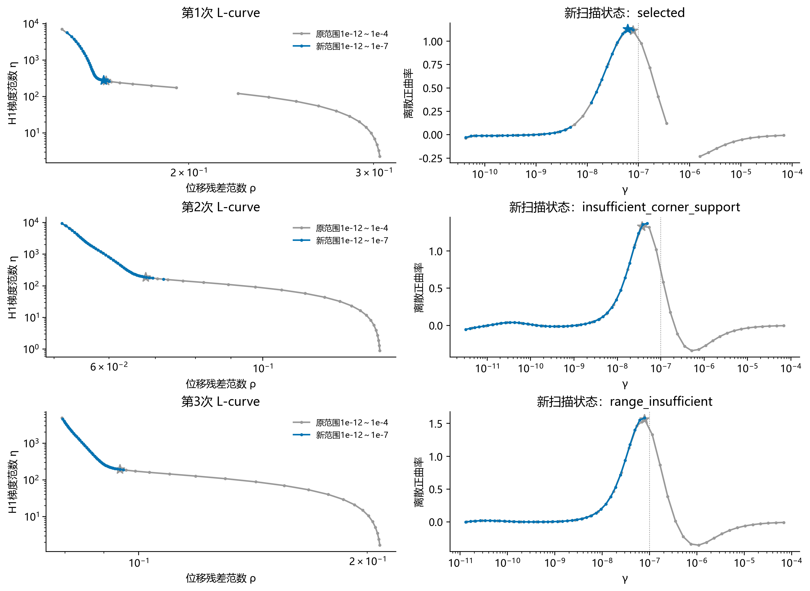
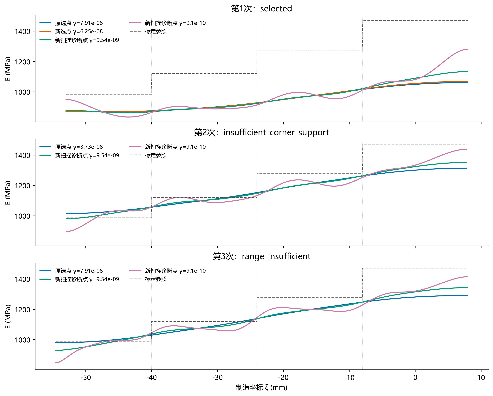

# 40%–70%区段：将γ上限从1e-4降至1e-7重新扫描

**结论：** 上限降低三个数量级后，三次主曲率峰仍在约5e-8至8e-8。第1次选得6.25055e-8，位移及参照差变化很小；第2次因峰邻近候选线搜索失败而缺少完整支撑，第3次因峰过近上界而未选参。此次重算没有得到10⁻⁹至10⁻⁸量级的正式L-curve选值。

三次独立参考图分别重新计算。仅修改扫描上限和运行身份；下限1e-12、50个候选、121×19单元、目标、ν、初值规则、容差和1500/12000预算保持不变。准备数组逐元素完全一致，原始数据及旧结果保留。运行过程中未调整参数或按中间结果重启。

| 次数 | 新扫描状态 | 原选γ | 新选γ | 曲率峰γ（诊断） | 函数停止成功点/50 |
|---|---|---:|---:|---:|---:|
| 1 | selected | 7.90604e-08 | 6.25055e-08 | 6.25055e-08 | 34/50 |
| 2 | insufficient_corner_support | 3.72759e-08 | 未选出 | 4.94171e-08 | 45/50 |
| 3 | range_insufficient | 7.90604e-08 | 未选出 | 7.90604e-08 | 40/50 |

L-curve必须有受支持的内部正曲率峰；若最大曲率靠近上界或邻近候选失败，则保存失败，不强制选择边界或残差最小点。没有选出γ的运行不能称为完成了正式反演；下表固定γ场只作诊断。

| 次数 | 场的身份 | γ | 轴向位移误差 % | 双分量位移误差 % | 四区平均绝对参照差 % | 横向离散 % |
|---|---|---:|---:|---:|---:|---:|
| 1 | 原扫描选点 | 7.90604e-08 | 1.351 | 6.677 | 21.155 | 4.237 |
| 1 | 新扫描选点 | 6.25055e-08 | 1.315 | 6.644 | 21.095 | 4.331 |
| 1 | 新扫描固定γ诊断 | 9.54095e-09 | 1.299 | 6.538 | 20.608 | 4.849 |
| 1 | 新扫描固定γ诊断 | 9.10298e-10 | 1.308 | 6.459 | 19.828 | 5.658 |
| 2 | 原扫描选点 | 3.72759e-08 | 1.099 | 2.507 | 5.831 | 0.759 |
| 2 | 新扫描固定γ诊断 | 9.54095e-09 | 1.084 | 2.420 | 5.071 | 0.865 |
| 2 | 新扫描固定γ诊断 | 9.10298e-10 | 1.027 | 2.284 | 4.178 | 1.725 |
| 3 | 原扫描选点 | 7.90604e-08 | 1.072 | 2.609 | 6.050 | 0.354 |
| 3 | 新扫描固定γ诊断 | 9.54095e-09 | 1.067 | 2.489 | 5.515 | 0.652 |
| 3 | 新扫描固定γ诊断 | 9.10298e-10 | 1.048 | 2.383 | 5.471 | 2.196 |

位移分母为同一DIC去刚体变形量；模量参照差以四区面积均值相对1023约束标定参照的绝对差求均值。参照不进入目标、初值或选γ。横向离散是去除宽度均值后的面积RMS/模量面积均值，不是噪声或置信区间。

50点覆盖范围变窄后，对数间距由8/49变为5/49，实际候选γ网格也改变；首次求解的γ从1e-4变成1e-7，收敛延续路径随之改变。这是改变上限的实际重算，不能将所有差异只归因于截断原曲线。

各图及统计中的诊断点均按预设目标1e-8/1e-9取最近候选，不按标定或重构形状选点。原选点与新选点采用相应扫描场；最终各ν优化的停止信息保存在逆问题元数据中。严格GTOL与函数下降停止分别保留，原失败不会因重绘被改称成功。

代表场重新正演及重新积分H1梯度范数，分别在相对1e-7及1e-8容差下与扫描记录吻合。输入、字段和元数据哈希见provenance.json；全部新50点扫描及冻结配置见run*_evidence。原载荷参考、厚度、材料定位及截取端均匀牵引假设保留；本平台回代是拟合检查。

## 运行目录与复现

四步仍分别运行项目原入口。后处理：`python -B -m lib.material_window_range_analysis --cases <三个新运行目录> --baselines <三个原裁剪目录> --output <新报告目录>`。

- D:\MyProject\uniform_pressure_experiment_1023\results\dic_full\sample2_1026_run1_h1_infill40_70_gmax1e7_20261027
- D:\MyProject\uniform_pressure_experiment_1023\results\dic_full\sample2_1026_run2_h1_infill40_70_gmax1e7_20261027
- D:\MyProject\uniform_pressure_experiment_1023\results\dic_full\sample2_1026_run3_h1_infill40_70_gmax1e7_20261027
