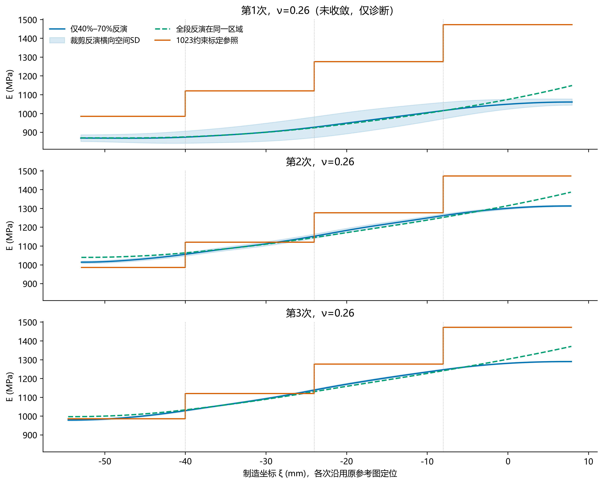
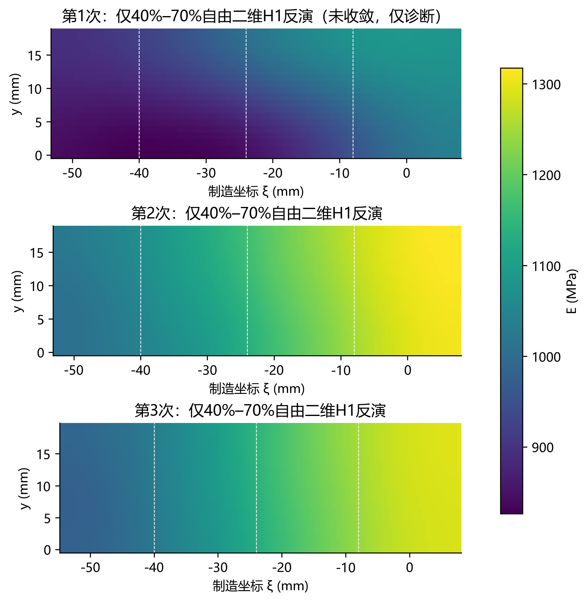

# 1026 sample_2：仅40%–70%区段的自由二维H1反演

**结果：** 第1次线搜索异常，以下仅为诊断场：四区平均绝对参照差由20.68%变为21.16%，双分量位移误差由6.61%变为6.68%。 第2次函数下降停止正常：四区平均绝对参照差由6.20%变为5.83%，双分量位移误差由2.57%变为2.51%。 第3次函数下降停止正常：四区平均绝对参照差由6.17%变为6.05%，双分量位移误差由2.64%变为2.61%。 异常计算：第1次ν=0.26、第3次ν=0.28。未重启优化、增加预算或按标定调整γ。

本次从三次独立参考图中分别裁剪40%、50%、60%、70%四区，仅使用裁剪后的DIC重新求初值、扫描γ并反演。全段反演只用于计算后的比较，未用于初始化或选参。

| 次数 | 方法 | γ | 轴向位移相对误差 % | 横向位移相对误差 % | 双分量相对误差 % | 四区模量平均绝对参照差 % |
|---|---|---:|---:|---:|---:|---:|
| 1 | 仅40%–70%反演（未收敛，仅诊断） | 7.91e-08 | 1.351 | 77.336 | 6.677 | 21.155 |
| 1 | 全段反演在同区评价 | 1.15e-07 | 1.497 | 76.173 | 6.612 | 20.680 |
| 1 | 四区标定正演 | — | 22.800 | 111.052 | 24.583 | — |
| 2 | 仅40%–70%反演 | 3.73e-08 | 1.099 | 28.044 | 2.507 | 5.831 |
| 2 | 全段反演在同区评价 | 1.15e-07 | 1.153 | 28.532 | 2.566 | 6.203 |
| 2 | 四区标定正演 | — | 4.480 | 28.717 | 5.027 | — |
| 3 | 仅40%–70%反演 | 7.91e-08 | 1.072 | 26.149 | 2.609 | 6.050 |
| 3 | 全段反演在同区评价 | 1.68e-07 | 1.083 | 26.418 | 2.636 | 6.165 |
| 3 | 四区标定正演 | — | 5.462 | 25.354 | 5.909 | — |

所有位移比较均在同一裁剪DIC点、同一面积权重与同一去刚体DIC变形分母下评价，全段场在这些点重新拟合三刚体自由度。分量误差不是逐点相除。四区指标为各区面积均值相对参照的绝对差的算术均值；共同积分网格沿两种有限元网格的全部单元边及制造界面细分，每个子矩形采用2×2 Gauss积分，对两种连续Q4场的均值及二阶矩均精确。

## 四区模量（主ν=0.26）

| 次数 | 填充率 % | 标定均值 MPa | 裁剪反演 MPa | 全段反演同区 MPa | 裁剪参照差 % |
|---|---:|---:|---:|---:|---:|
| 1 | 40 | 985.32 | 869.50 | 871.00 | -11.75 |
| 1 | 50 | 1119.96 | 896.14 | 895.77 | -19.99 |
| 1 | 60 | 1276.05 | 971.11 | 966.79 | -23.90 |
| 1 | 70 | 1472.30 | 1045.55 | 1076.77 | -28.99 |
| 2 | 40 | 985.32 | 1028.96 | 1047.18 | +4.43 |
| 2 | 50 | 1119.96 | 1101.69 | 1100.91 | -1.63 |
| 2 | 60 | 1276.05 | 1208.94 | 1197.34 | -5.26 |
| 2 | 70 | 1472.30 | 1295.57 | 1315.28 | -12.00 |
| 3 | 40 | 985.32 | 996.05 | 1008.66 | +1.09 |
| 3 | 50 | 1119.96 | 1080.88 | 1078.53 | -3.49 |
| 3 | 60 | 1276.05 | 1195.59 | 1185.40 | -6.31 |
| 3 | 70 | 1472.30 | 1276.24 | 1303.17 | -13.32 |

## 输入、方法和限制

裁剪窗口为制造坐标[-57,8] mm。各次坐标锚点仅来自本次同一帧组的原全段冻结输入；不重新居中、不缩放、不在不同参考图之间共享锚点。40%区受原DIC覆盖限制，只比较现有覆盖部分；70%区末端不足一行采样间距。原始坐标、位移、网格ID均逐项核验为原全段的严格子集。

| 次数 | 实际制造范围 mm | DIC点数 | 原点数 | 裁剪长×宽 mm |
|---|---|---:|---:|---:|
| 1 | -52.9630 至 7.9679 | 11760 | 20400 | 60.9309×18.4355 |
| 2 | -52.8875 至 7.8236 | 11700 | 20340 | 60.7111×18.4637 |
| 3 | -54.5276 至 7.8816 | 11895 | 20740 | 62.4092×19.3018 |

保持121×19单元、2440个独立节点模量和独立y行；裁剪后轴向单元变细，因此本实验同时改变域长度、观测范围、端面位置及轴向网格间距，不能将差异单独归因于去掉高填充区。原载荷增量229.2224/309.3808/397.7152 N、厚度3.2 mm、承载宽度及各次参考对应假设保留。新截取端面采用均匀牵引近似，未测得该内部截面的实际牵引分布。

H1目标、50点γ=1e-12至1e-4、1500迭代/12000函数预算、FTOL/GTOL与原全段一致。主ν=0.26；0.24/0.28/0.33仅作固定γ敏感性分析。使用1023的individual_window_joint_3pct_monotone外部参照；组内3%及单调性为标定选窗约束，非独立验证性质。参照不进入反演目标、初值和选参。

## 求解停止与核验

| 次数 | ν | 函数停止成功 | GTOL满足 | 梯度∞范数 | 停止信息 |
|---|---:|---|---|---:|---|
| 1 | 0.24 | True | False | 4.08e-09 | CONVERGENCE: RELATIVE REDUCTION OF F <= FACTR*EPSMCH |
| 1 | 0.26 | False | False | 5.62e-09 | ABNORMAL:  |
| 1 | 0.28 | True | False | 4.76e-09 | CONVERGENCE: RELATIVE REDUCTION OF F <= FACTR*EPSMCH |
| 1 | 0.33 | True | False | 5.12e-09 | CONVERGENCE: RELATIVE REDUCTION OF F <= FACTR*EPSMCH |
| 2 | 0.24 | True | False | 9.09e-10 | CONVERGENCE: RELATIVE REDUCTION OF F <= FACTR*EPSMCH |
| 2 | 0.26 | True | False | 1.05e-09 | CONVERGENCE: RELATIVE REDUCTION OF F <= FACTR*EPSMCH |
| 2 | 0.28 | True | False | 1.91e-09 | CONVERGENCE: RELATIVE REDUCTION OF F <= FACTR*EPSMCH |
| 2 | 0.33 | True | False | 1.52e-09 | CONVERGENCE: RELATIVE REDUCTION OF F <= FACTR*EPSMCH |
| 3 | 0.24 | True | False | 1.83e-09 | CONVERGENCE: RELATIVE REDUCTION OF F <= FACTR*EPSMCH |
| 3 | 0.26 | True | False | 7.08e-10 | CONVERGENCE: RELATIVE REDUCTION OF F <= FACTR*EPSMCH |
| 3 | 0.28 | False | False | 6.13e-10 | ABNORMAL:  |
| 3 | 0.33 | True | False | 1.11e-09 | CONVERGENCE: RELATIVE REDUCTION OF F <= FACTR*EPSMCH |

三次均完成各自50点扫描；扫描成功数见summary.csv，完整失败候选保留在各运行目录。每个ν均额外重做一次正演，保存残差在绝对1e-10 mm容差下重现；核验原始CSV哈希、坐标锚点哈希、同区原始数据、载荷、权重及求解设置。函数下降停止与GTOL满足分别报告。

位移回代是使用过的数据的拟合检查；较好的拟合或较小的参照差不能证明绝对模量正确。载荷参考未同步核实、厚度/尺度假设、条件材料定位和截面边界等效限制仍然成立。三次来自同一试样，不作为三根独立样本。

## 复现

四步分别运行项目script的step1至step4入口；第2至4步显式--input指向各01_prepared。冻结配置、输入哈希、全量50点扫描及原始数组保存在下列运行目录：

- D:\MyProject\uniform_pressure_experiment_1023\results\dic_full\sample2_1026_run1_h1_infill40_70_20261027
- D:\MyProject\uniform_pressure_experiment_1023\results\dic_full\sample2_1026_run2_h1_infill40_70_20261027
- D:\MyProject\uniform_pressure_experiment_1023\results\dic_full\sample2_1026_run3_h1_infill40_70_20261027

后处理命令与环境见environment.json；同区对照数据见summary.csv、regional_comparison.csv、axial_profiles.csv；12组停止证据见solver_stopping.csv；审计见audit.json。已有数值结果与原始数据未覆盖。
