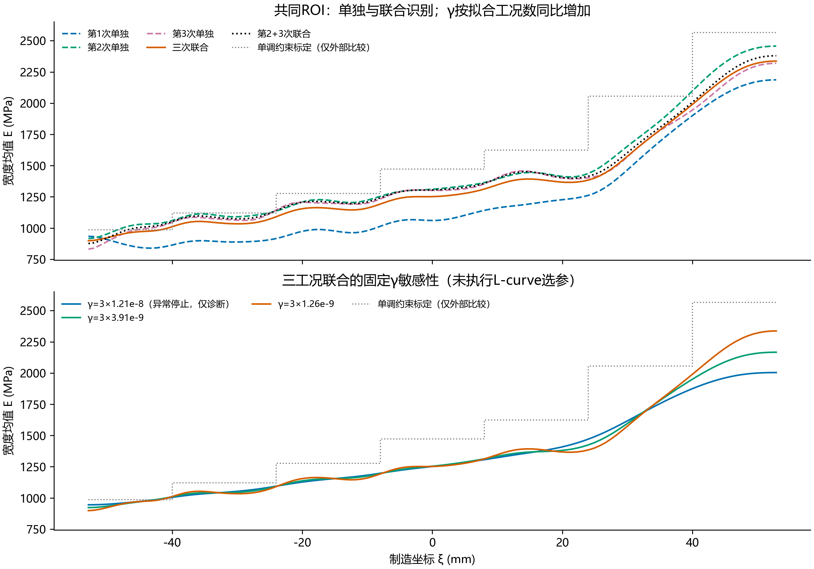

# 三次独立参考图的条件联合反演试算

**结论：** 可以在算法上共享一个自由二维模量场，但本次三个数据集与共同材料场假设的相容性不足。共同ROI单独识别时，第1/2/3次轴向误差为1.19%/0.85%/0.75%；三工况联合后变为14.43%/4.91%/3.48%。不建议直接用三次联合结果替换各次结果。

第2+3次联合的轴向误差为1.33%/1.10%，与两次单独解更相容。这个子集诊断是在看到工况差异后做的，不能作为预先独立验证或剔除第1次的依据。

共同二维模量场，三个独立位移解和刚体配准。所有结果限定于标线/横向中点对应、线弹性与共同材料性质假设；没有验证三个参考图中的材料点对应，也未同步核实起末载荷。不是正式四步联合识别或独立验证。

共同域105.774937554×18.435507949 mm，厚度3.2 mm，121×19自由二维H1，ν=0.26。取原三个中心对齐ROI的交集，保持毫米尺度，仅裁点与平移，不缩放；保留原位移和面积权重。每个工况端力按原牵引×共同宽度×厚度换算，保持其原牵引。

目标为0.5 Σ rᵀWr+0.5γ∫|∇E|²；各工况刚体模式分别消除。对照按γ=n_fit×γ_base配置，相当于平均数据项搭配同γ_base，但代码始终使用原始数据项之和；没有按力、噪声或相对误差重加权。本诊断采用预先给定三个γ_base，不宣称是联合L-curve最优。

三工况γ从3.79e-9提高到1.17e-8，三个轴向误差分别仅由14.425/4.911/3.475%变为14.433/4.933/3.481%，表明在已试范围内，相容性问题对γ不敏感。最高候选3.62e-8返回ABNORMAL，仅作诊断；其余6组因函数相对下降停止，7组均未满足GTOL=1e-12。

| 方案 | 评价工况 | 是否参与拟合 | 轴向相对误差 % | 横向相对误差 % | 双分量相对误差 % |
|---|---|---|---:|---:|---:|
| joint123_small | run1 | True | 14.425 | 72.731 | 18.557 |
| joint123_small | run2 | True | 4.911 | 51.965 | 5.718 |
| joint123_small | run3 | True | 3.475 | 73.108 | 5.191 |
| single1 | run1 | True | 1.190 | 26.365 | 4.474 |
| single1 | run2 | False | 22.255 | 283.412 | 27.412 |
| single1 | run3 | False | 20.535 | 322.438 | 26.652 |
| single2 | run1 | False | 18.358 | 83.171 | 22.660 |
| single2 | run2 | True | 0.847 | 33.417 | 2.073 |
| single2 | run3 | False | 2.046 | 38.771 | 2.892 |
| single3 | run1 | False | 17.175 | 89.780 | 22.433 |
| single3 | run2 | False | 1.989 | 42.858 | 3.137 |
| single3 | run3 | True | 0.754 | 30.261 | 1.766 |
| joint23_small | run1 | False | 17.642 | 87.131 | 22.505 |
| joint23_small | run2 | True | 1.330 | 37.544 | 2.507 |
| joint23_small | run3 | True | 1.095 | 31.610 | 1.995 |
| joint123_middle | run1 | True | 14.433 | 72.773 | 18.567 |
| joint123_middle | run2 | True | 4.933 | 52.217 | 5.745 |
| joint123_middle | run3 | True | 3.481 | 73.283 | 5.201 |
| joint123_large | run1 | True | 14.450 | 72.878 | 18.591 |
| joint123_large | run2 | True | 4.976 | 52.468 | 5.789 |
| joint123_large | run3 | True | 3.495 | 73.388 | 5.215 |

所有工况及标定参照此前均已用于诊断；未参与某个试算子集的工况只称跨工况检查，不能称预先留出的最终验证。

相同方向、相同边界形态的线弹性加载仅改变幅值，u_c∝牵引；它不会像改变加载方向那样提供新的力学激励。联合可以汇总重复观测、检验共同E假设，但不能自动消除参考载荷、厚度、定位、蠕变、损伤或DIC系统差异。

核验：共同ROI观测与原保留点逐元素一致；牵引换算守恒；8×3小网格三工况目标/梯度之和一致性、确定性log-E方向中心差分，以及1.7倍力的位移线性比例核验；每个识别场重新正演，联合残差范数核对到1e-8相对容差。停止标志与严格GTOL分别保存，不能以优化停止证明共同E假设成立。

复现：`python -u -B -m lib.joint_reference_diagnostic --cases <三个完整ROI冻结目录> --output <新输出目录>`。初值仅由三个工况DIC联合均匀拟合得到，标定不进入目标、初值或γ。
