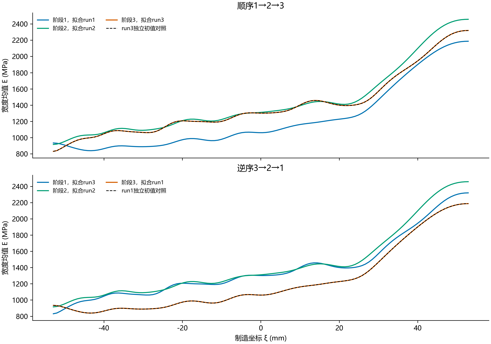

# 顺序工况反演：只传递上一模量场作为初值

按用户指定定义：E0→工况1识别E1→以E1初始化工况2识别E2→以E2初始化工况3识别E3；另做3→2→1逆序对照。每阶段只优化当前工况的数据项和同一个H1正则项，不保留先前残差、梯度或L-BFGS历史，也不添加向上一模量场靠拢的惩罚。

共同ROI、点集、权重、牵引、121×19自由二维网格和ν=0.26与前一次联合试算一致。γ固定1.2648552168552956e-9，不按工况数倍增，因为每阶段只有一个数据项。单独对照的均匀初值只由该工况DIC确定，顺序路径的首阶段复用完全相同的单独求解；后续模量初值逐元素核对与上一结果一致。共7次优化，形成3个单独对照与2条各3阶段路径。

| 路径 | 阶段 | 当前拟合工况 | 第1次轴向相对误差 % | 第2次轴向相对误差 % | 第3次轴向相对误差 % | 与当前工况单独解场差异 % |
|---|---:|---|---:|---:|---:|---:|
| forward | 1 | run1 | 1.1905 | 22.2549 | 20.5350 | 0.000000 |
| forward | 2 | run2 | 18.3580 | 0.8468 | 2.0460 | 0.000008 |
| forward | 3 | run3 | 17.1752 | 1.9894 | 0.7542 | 0.000007 |
| reverse | 1 | run3 | 17.1752 | 1.9894 | 0.7542 | 0.000000 |
| reverse | 2 | run2 | 18.3580 | 0.8468 | 2.0460 | 0.000013 |
| reverse | 3 | run1 | 1.1905 | 22.2549 | 20.5350 | 0.000013 |

初值传递能影响优化路径、迭代数和可能的局部解，但当前目标不再包含先前工况的残差，因此不保证保留先前拟合。终点与最后一个工况单独解的差异是本实验检验的量，不预先假定必定相同。

每阶段预算1500迭代/12000目标评价，FTOL=1e-30、GTOL=1e-12；一条三阶段路径具有三个阶段预算，与一个单工况的总预算不同。不把函数停止当作严格一阶最优。若前阶段未报告求解成功，则后续阶段停止并保留失败结果。

三个独立参考图的共同材料坐标、首载与参考图对应及名义末载仍为原假设；这是顺序流程敏感性诊断，没有正式重新选γ，也不构成新的独立物理验证。标定只在求解结束后比较，逐工况交叉回代不称独立留出测试。

核验：初值传递逐元素一致；当前工况正演残差范数与优化器结果在1e-8相对容差内核对；原冻结输入哈希不变。

复现：`python -u -B -m lib.sequential_case_diagnostic --cases <三个完整ROI冻结目录> --output <新输出目录>`。
