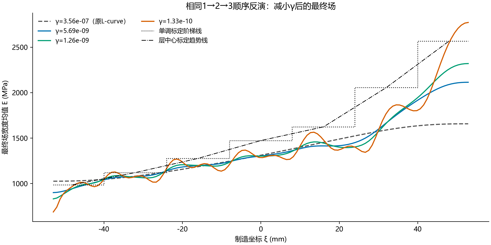
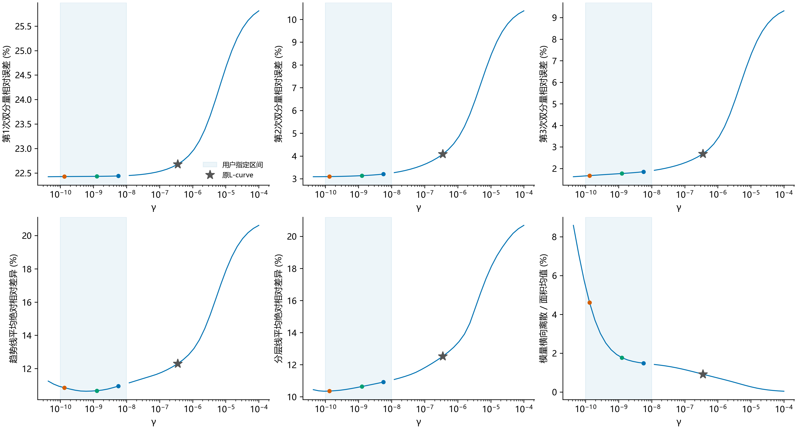
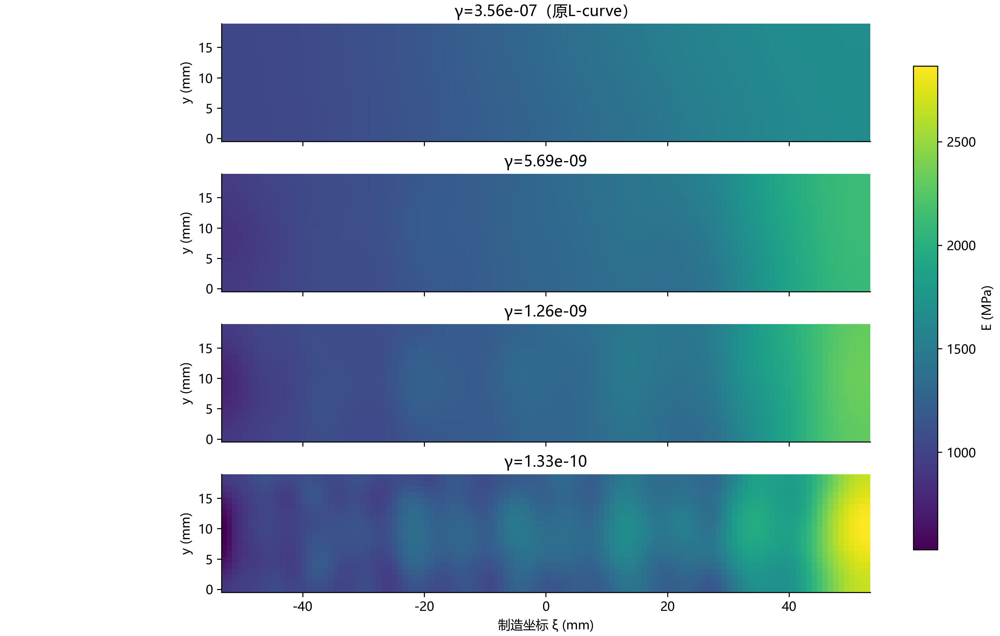

# 顺序反演：γ在1e-10至1e-8内是否改善

只回放现有扫描，不重新优化或替换选参结果。原50个γ中有12个位于指定区间，11个完整有效；8.2864e-9的第3阶段线搜索异常，保留失败，不计入成功比较。回放全部39个有效最终场以提供完整上下文，所有比较都用同一共同ROI、数据、载荷、权重、网格和ν。

**结论：** 该区间能减轻原L-curve点的平滑偏差，尤其改善第2、3次位移拟合与标定参照差异；第1次约17%的轴向误差基本保留。约1e-9可作为折中诊断候选；降至1e-10量级，分层线差异和第3次拟合继续改善，但趋势线差异不再持续降低，横向离散和局部起伏明显增加。不能把整个区间或最小γ都称为最优。

| γ | 第1次轴向误差 % | 第2次轴向误差 % | 第3次轴向误差 % | 趋势线差异 % | 分层线差异 % | 横向离散 % | H1范数/原值 |
|---|---:|---:|---:|---:|---:|---:|---:|
| 3.556e-07 | 17.338 | 2.988 | 1.852 | 12.301 | 12.529 | 0.915 | 1.00 |
| 5.69e-09 | 17.181 | 2.061 | 0.848 | 10.946 | 10.918 | 1.482 | 2.22 |
| 1.265e-09 | 17.175 | 1.989 | 0.754 | 10.670 | 10.640 | 1.768 | 3.21 |
| 1.326e-10 | 17.173 | 1.970 | 0.640 | 10.852 | 10.357 | 4.607 | 7.66 |

代表点在比较标定前固定：指定区间内最接近1e-8、前已讨论的1.264855e-9、1e-10的有效网格点。没有在新边界1e-10或1e-8补算精确点。完整区间数据包含全部11个有效点和1个失败点，不只保留代表点。

趋势线与阶梯线差异均为最终宽度均值曲线在制造坐标[−48,48] mm的平均绝对相对差异。七层均值误差、完整ROI阶梯线差异和L₂差异另存CSV，不能与本表混称。模量横向离散为去除宽度均值后的二维Q4面积标准差/面积均值，不是置信区间或DIC噪声估计。H1范数增加可能来自材料变化与误差吸收两者，不能仅凭起伏将其判为噪声。

位移误差按原面积权重和该工况去刚体DIC变形量作整体分母；每个γ均用同一最终场回代三个工况，不混用不同阶段场。所有完整链按函数下降停止，均未满足严格GTOL，物理定位与力参考假设仍保留。标定只作事后诊断，不能按最接近标定点改称正式最优γ。原顺序端点L-curve选择与原文件保持不变。

核验：39个最终场各自重新正演三个工况，逐工况相对误差与原缓存核对；总残差范数与H1范数分别在1e-8和1e-9相对容差内核对，原冻结输入哈希不变。模量统计使用Q4 Gauss积分，标定曲线积分沿节点、层界及误差过零点精确切分，并沿用6点/12点积分一致性核验。

复现：`python -B -m lib.sequential_gamma_band --study <已完成顺序L-curve扫描目录> --output <新目录>`。
