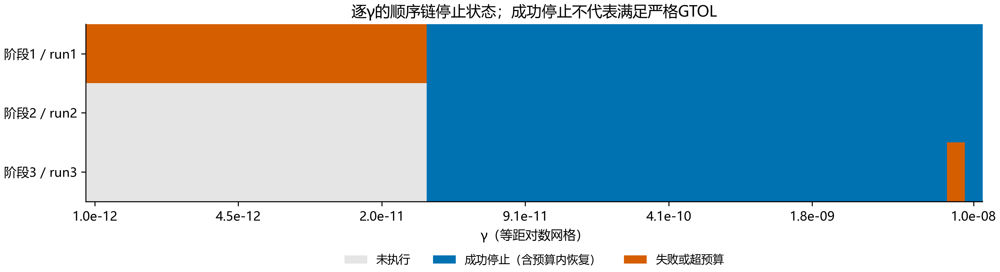
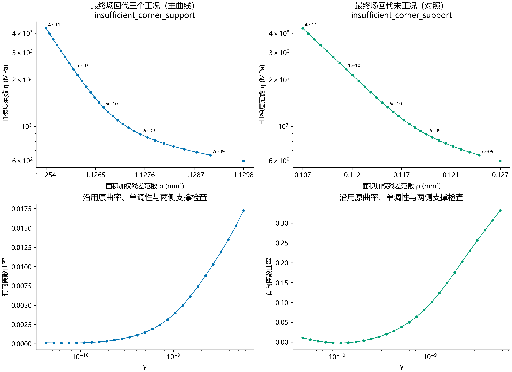
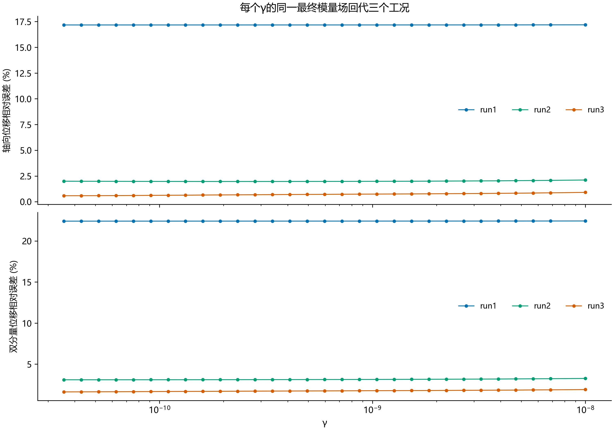

# 每个γ内执行完整1→2→3的顺序反演与L-curve

50个γ，范围1e-12–1e-08。共112个已执行阶段，30条完整成功顺序链，20个无效γ。每个γ从相同的工况1 DIC均匀初值出发，无跨γ续算；同γ内逐元素传递E1→E2→E3，每阶段只有当前工况目标。

**主选点口径：** 取同一个最终场E3(γ)，分别正演并配准三个工况，ρ=sqrt(Σ r_c(E3)ᵀW_c r_c(E3))；η=sqrt(∫|∇E3|²)，不把γ乘进范数。没有混用E1拟合工况1、E2拟合工况2、E3拟合工况3的残差。

主曲线是顺序端点的多工况几何诊断：E3只最小化最后工况的目标，没有最小化总残差目标。因此它不是同时联合目标的标准Tikhonov解路径，也不保证沿γ单调。另保存末工况残差曲线与三个阶段各自曲线以区分选点定义。所有曲线使用原离散正曲率、相邻有效点、两侧各两点支撑与单调性规则；没有有效拐点时保留失败，不按标定补γ。

| 曲线 | 选点状态 | γ |
|---|---|---:|
| all_cases_endpoint | insufficient_corner_support | 未选定 |
| terminal_case | insufficient_corner_support | 未选定 |

主曲线未选定时，不用末工况对照结果冒充三工况选点。末工况曲线若有拐点，仅说明顺序末阶段的拟合与H1之间有该几何折中。

每阶段最多1500迭代/12000评价，FTOL=1e-30、GTOL=1e-12。ABNORMAL最多用原剩余预算重置历史两次，首次异常、重启和总开销均记录。最终阶段失败或超预算的γ不进入端点选点，前一阶段失败则停止该链。92/112个阶段报告成功，严格GTOL通过0个；函数停止不是严格一阶最优性证明。

单调约束标定仅在选点后用于趋势线与分层线相对差异比较。它不参与初值、阶段目标、γ或拐点选择。位移报告面积加权相对误差，分母为该工况DIC去刚体变形量，非逐点位移相除。

共同域105.774937554×18.435507949 mm，121×19自由二维H1，厚度3.2 mm、ν=0.26；沿用前次共同中心定位与各次起末载荷假设。独立参考图未被当作同一参考图，分别去除三刚体模式；材料点对应仍未独立核实，回代也不是独立验证。

核验：每γ相同初值、同γ阶段间初值逐元素一致；逐阶段正演ρ与优化器值相对容差1e-8核对，η相对容差1e-9核对；同一最终场的三工况ρ同时以代价之和与加权残差拼接范数独立核对；原冻结输入哈希不变。

复现扫描：`python -u -B -m lib.sequential_lcurve_scan --cases <三个完整ROI冻结目录> --output <新目录> --gamma-log10-range -12 -8`；完全相同协议的完整缓存可用`--resume`。后处理：`python -B -m lib.sequential_lcurve_report --study <扫描目录> --output <新的报告目录>`。
