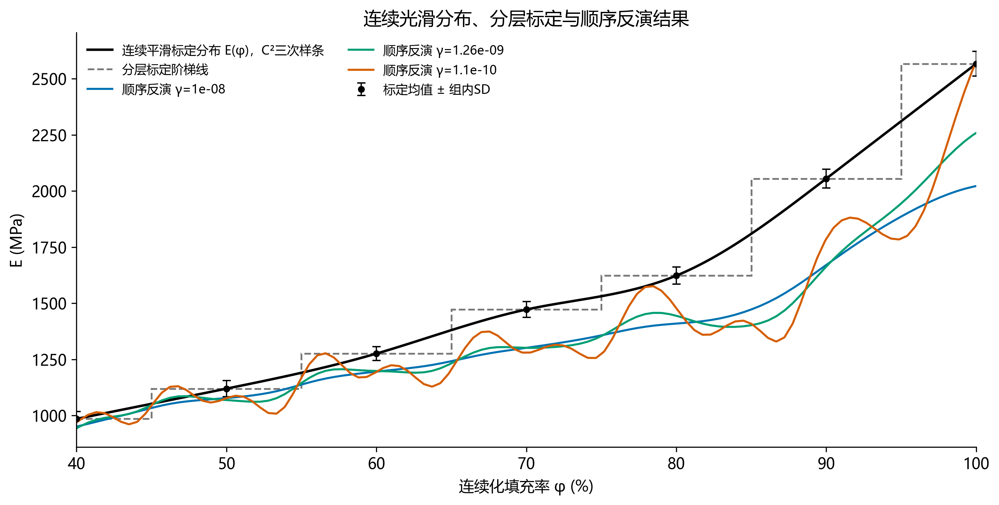
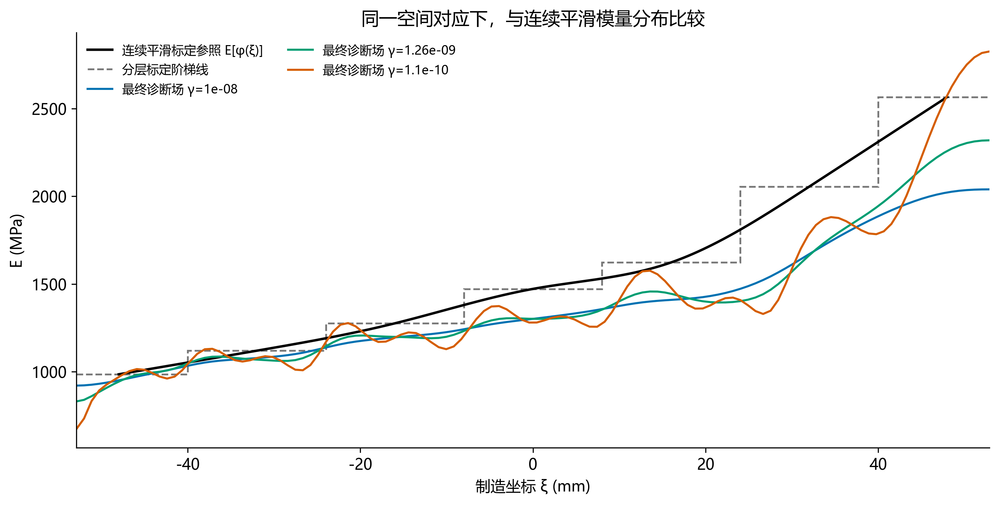
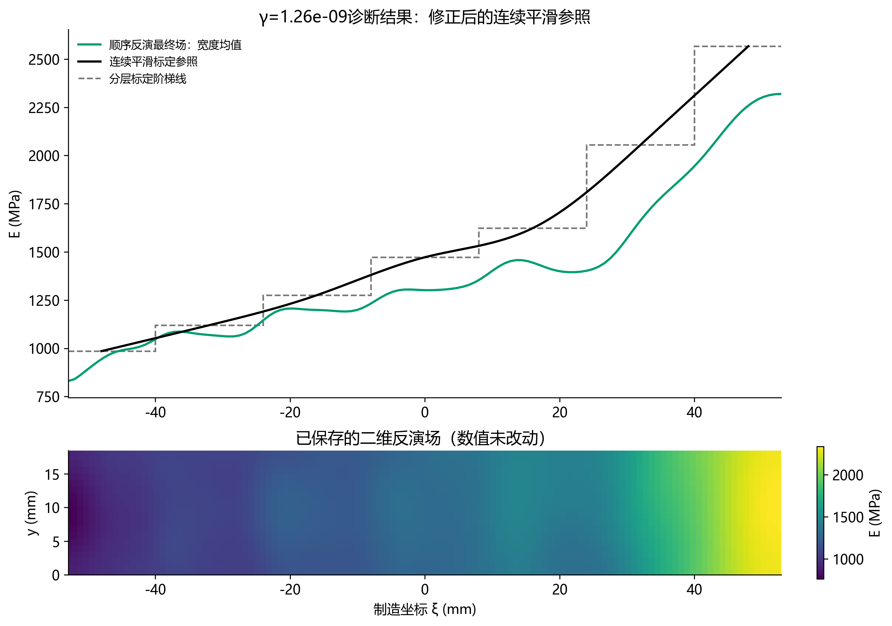

# 修正：连续光滑的随填充率变化模量分布

此前的层中心分段直线不是用户指定的连续光滑参照。本报告改用七个1023单调约束标定均值构造E(φ)自然三次样条：通过所有均值，整段C²连续；解析核验最小导数为10.984244 MPa/填充率百分点，保持单调不减。没有为贴近反演调节标定均值或曲线参数。

先在填充率40%–100%上定义连续E(φ)，再沿既有层中心位置关系φ=70+0.625ξ映射到制造坐标[-48,48] mm。这是把分层参照连续化的比较约定，不把实物分层直接宣称为连续真值；不更改坐标尺度，也不在40%–100%之外外推。

新的平均绝对相对差异为100/96×∫[-48,48]|Ē_inverse(ξ)/E_smooth[φ(ξ)]−1|dξ。与旧线性参照、原阶梯线采用相同支持区间和最终模量场。反演、位移误差、γ、L-curve失败状态均未重算或覆盖。

| γ | 连续光滑参照差异 % | 旧层中心折线差异 %（历史口径） | 原阶梯线差异 % |
|---|---:|---:|---:|
| 1e-08 | 10.8194 | 11.0927 | 11.0363 |
| 1.265e-09 | 10.4018 | 10.6701 | 10.6398 |
| 1.099e-10 | 10.6730 | 10.8924 | 10.3461 |

原30个有效最终场均按新参照重算，见all_smooth_reference_errors.csv。图中同时保留黑色实线的连续光滑E(φ)和灰色虚线的分层标定阶梯线；阶梯误差作为分层表示的独立对照，旧层中心折线不再冒充光滑参照。

核验：标定均值逐点通过，逐区间导数最小值与C²拼接解析检查；相对差异积分在节点、样条结点与误差多项式实根处切分，8点/16点Gauss一致；三个展示点另以独立自适应quad核对。常值场10%差异解析检查通过。原准备数据哈希不变。

复现：`python -B -m lib.smooth_calibration_reference --study <新范围顺序扫描目录> --output <新输出目录>`。
